# Google Cloud for AI Engineers: Zero to Hero

### A field guide for someone who already knows AWS and the open-source AI stack

> Written November 2026. This guide assumes you've built agents, RAG systems and model-serving platforms on AWS (Bedrock, AgentCore, SageMaker, OpenSearch) and with open source (LangGraph, LiteLLM, vLLM, FastMCP, OpenTelemetry). It doesn't re-teach what RAG or tool calling is. It teaches **how Google does it**: the products, the names, the SDKs, the IAM model, the gotchas, and how the pieces connect.
>
> Companion files: `GCP_DeepDive.md` goes deep on one workload (RAG ingestion + agentic query on Google Cloud). This file covers the **whole Google AI engineering surface**.
>
> Google renamed a lot in 2026 and ships models almost monthly. Every model ID, quota and API shape here should be checked against current docs before you rely on it. I flag the spots that are most likely to drift.

---

## How to read this

The guide is organized as levels. Each level ends with a short "you should now be able to" checklist.

| Level | Theme | Sections |
|---|---|---|
| 0 | Orientation: the map, the names, the translation from AWS | 1 to 4 |
| 1 | Foundations: projects, IAM, locations, quotas, tooling | 5 to 10 |
| 2 | Models: Gemini, the Gen AI SDK, built-in tools, Model Garden, tuning, serving | 11 to 17 |
| 3 | Data and retrieval: embeddings, search options, Document AI, BigQuery as an AI engine | 18 to 22 |
| 4 | Agents: Agent Platform, ADK in depth, Agent Runtime, Memory Bank, Agent Studio | 23 to 27 |
| 5 | Connecting agents: MCP on Google Cloud, A2A, governance (Identity, Registry, Gateway) | 28 to 30 |
| 6 | Apps on top: Gemini Enterprise, Gemini Enterprise for CX and CX Agent Studio | 31 to 32 |
| 7 | Production: reference architectures, security, observability, evaluation, LLMOps, cost | 33 to 38 |
| 8 | Getting good fast: 90-day plan, certifications, cheat sheets, gotchas, glossary | 39 to 43 |

---

## Contents

**Level 0: Orientation**
1. [The Google AI stack in one picture](#1-the-google-ai-stack-in-one-picture)
2. [Name decoder: old names, new names](#2-name-decoder-old-names-new-names)
3. [AWS → Google Cloud translation](#3-aws--google-cloud-translation)
4. [Two doors to Gemini: Gemini Developer API vs Agent Platform](#4-two-doors-to-gemini-gemini-developer-api-vs-agent-platform)

**Level 1: Foundations**

5. [Resource hierarchy, projects and billing](#5-resource-hierarchy-projects-and-billing)
6. [IAM for AI engineers](#6-iam-for-ai-engineers)
7. [Locations, the global endpoint and data residency](#7-locations-the-global-endpoint-and-data-residency)
8. [Networking you actually need](#8-networking-you-actually-need)
9. [Quotas and capacity: DSQ, Provisioned Throughput, batch](#9-quotas-and-capacity-dsq-provisioned-throughput-batch)
10. [Your toolbox: gcloud, SDKs, IDEs, notebooks, starter kits](#10-your-toolbox-gcloud-sdks-ides-notebooks-starter-kits)

**Level 2: Models**

11. [The Gemini model family](#11-the-gemini-model-family)
12. [The Gen AI SDK in depth](#12-the-gen-ai-sdk-in-depth)
13. [Built-in tools and grounding](#13-built-in-tools-and-grounding)
14. [Caching, batch, Live API and media models](#14-caching-batch-live-api-and-media-models)
15. [Model Garden: Claude, Llama, Gemma and open models](#15-model-garden-claude-llama-gemma-and-open-models)
16. [Customizing models: prompts, tuning, distillation](#16-customizing-models-prompts-tuning-distillation)
17. [Serving your own models: endpoints, GKE, Cloud Run GPUs](#17-serving-your-own-models-endpoints-gke-cloud-run-gpus)

**Level 3: Data and retrieval**

18. [Embeddings](#18-embeddings)
19. [Choosing a retrieval backend](#19-choosing-a-retrieval-backend)
20. [Document AI and parsing](#20-document-ai-and-parsing)
21. [Ranking and grounding-check APIs](#21-ranking-and-grounding-check-apis)
22. [BigQuery as an AI engine (and the rest of the data platform)](#22-bigquery-as-an-ai-engine-and-the-rest-of-the-data-platform)

**Level 4: Agents**

23. [Gemini Enterprise Agent Platform: the map](#23-gemini-enterprise-agent-platform-the-map)
24. [ADK from zero to hero](#24-adk-from-zero-to-hero)
25. [Agent Runtime](#25-agent-runtime)
26. [Sessions and Memory Bank](#26-sessions-and-memory-bank)
27. [Agent Studio, Agent Designer and Agent Garden](#27-agent-studio-agent-designer-and-agent-garden)

**Level 5: Connecting agents**

28. [MCP on Google Cloud](#28-mcp-on-google-cloud)
29. [A2A: agent-to-agent](#29-a2a-agent-to-agent)
30. [Governance: Agent Identity, Registry, Gateway](#30-governance-agent-identity-registry-gateway)

**Level 6: Apps on top**

31. [Gemini Enterprise (the employee app)](#31-gemini-enterprise-the-employee-app)
32. [Gemini Enterprise for CX and CX Agent Studio](#32-gemini-enterprise-for-cx-and-cx-agent-studio)

**Level 7: Production**

33. [Reference architectures](#33-reference-architectures)
34. [Security and responsible AI](#34-security-and-responsible-ai)
35. [Observability](#35-observability)
36. [Evaluation, simulation and optimization](#36-evaluation-simulation-and-optimization)
37. [LLMOps: CI/CD and infrastructure as code](#37-llmops-cicd-and-infrastructure-as-code)
38. [Cost and performance](#38-cost-and-performance)

**Level 8: Getting good fast**

39. [A 90-day plan](#39-a-90-day-plan)
40. [Certifications and learning resources](#40-certifications-and-learning-resources)
41. [Cheat sheets](#41-cheat-sheets)
42. [Gotchas for AWS people](#42-gotchas-for-aws-people)
43. [Glossary](#43-glossary)

---

# Level 0: Orientation

## 1. The Google AI stack in one picture

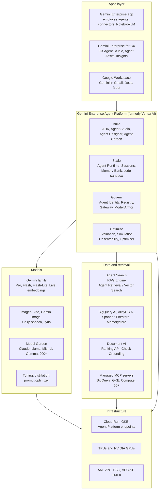

Read it bottom-up. **Infrastructure** is plain Google Cloud. **Models** are Gemini plus everything in Model Garden. **Data and retrieval** is where your knowledge lives. **Agent Platform** is the AI engineering workbench, organized around four verbs. On top sit the **apps** that business users touch: Gemini Enterprise for employees and Gemini Enterprise for CX for customers.

As an AI engineer you'll spend most of your time in the middle two layers: Agent Platform (mostly ADK, Agent Runtime, evaluation) and data/retrieval, with frequent trips down to Cloud Run, IAM and networking, and up to Gemini Enterprise when you publish agents to employees or to CX Agent Studio when you build customer-facing voice and chat.

## 2. Name decoder: old names, new names

You will read docs, blog posts, Stack Overflow answers and SDK code from 2023 to 2026. They use different names for the same thing. Keep this table close.

| You'll see | It means (Nov 2026) | Notes |
|---|---|---|
| Vertex AI | **Gemini Enterprise Agent Platform** ("Agent Platform") | Rebranded April 2026; APIs stayed backward compatible; hostnames still `aiplatform.googleapis.com`; IAM roles still `roles/aiplatform.*` |
| Vertex AI Agent Builder | Agent Platform (Build pillar) | The old umbrella for agent tooling |
| Vertex AI Agent Engine / Reasoning Engine | **Agent Runtime** | Terraform resource is still `google_vertex_ai_reasoning_engine`; SDK modules often still say `agent_engines` |
| Vertex AI Search / Enterprise Search / Gen App Builder | **Agent Search** | API is still Discovery Engine (`discoveryengine.googleapis.com`) |
| Vertex AI Vector Search (Matching Engine) | **Vector Search** (1.0) | SDK classes still say `MatchingEngineIndex` |
| Vertex AI Vector Search 2.0 | **Agent Retrieval** | Collections + data objects, built-in hybrid |
| Vertex AI RAG Engine | **RAG Engine** | Same product |
| Vertex AI Studio / Generative AI Studio | Agent Platform studio experiences (prompting, tuning) | Console UI |
| Google Agentspace | **Gemini Enterprise** (app) | Employee-facing agent and search app |
| Duet AI | Gemini for Google Cloud / Gemini Code Assist | Developer assistance |
| Contact Center AI (CCAI), Customer Engagement Suite | **Gemini Enterprise for Customer Experience (CX)** | Launched Jan 2026 at NRF |
| Dialogflow CX / Conversational Agents | Still exists; **CX Agent Studio** is the new-codebase successor | CX Agent Studio is GA |
| Bard, PaLM, text-bison, chat-bison | Gone | Ignore anything built on them |
| `vertexai.generative_models` (old SDK) | **Google Gen AI SDK** (`google-genai`) | The old generative module is deprecated; use `google-genai` |
| Dataproc | Also marketed as Managed Service for Apache Spark | Same Spark you know |
| Kubeflow Pipelines on Vertex | Agent Platform Pipelines | Still KFP |

When a doc page and the console disagree on a name, trust the console and the API reference.

## 3. AWS → Google Cloud translation

### 3.1 Platform and identity

| AWS | Google Cloud | The difference that matters |
|---|---|---|
| Account | **Project** | Projects are cheap and disposable; create many |
| Organization / OU | Organization / **Folder** | Policies inherit down the tree |
| IAM role (assumed) | **Service account** (impersonated) | Workloads *are* service accounts; humans impersonate them |
| IAM policy on identity | **IAM policy on resource** (bindings) | You grant `role` to `member` *on a resource* |
| SCP | **Organization Policy** constraints | Plus deny policies |
| STS AssumeRole | Service account impersonation, `generateAccessToken` | `gcloud --impersonate-service-account` |
| IRSA / EKS Pod Identity | **Workload Identity Federation for GKE** | |
| OIDC federation for GitHub | **Workload Identity Federation** | No keys, ever |
| Region / AZ | Region / zone | Some AI services also have **multi-region** (`us`, `eu`) and a **global** endpoint |
| VPC endpoint (PrivateLink) | **Private Service Connect** / Private Google Access | |
| Perimeter-ish controls | **VPC Service Controls** | No direct AWS equivalent; very powerful |
| KMS CMK | Cloud KMS **CMEK** | |
| CloudTrail | Cloud Audit Logs (Admin Activity on by default; **Data Access off by default**) | Turn Data Access logs on for AI services |
| CloudWatch | Cloud Logging + Cloud Monitoring + Cloud Trace | |
| Secrets Manager | Secret Manager | |
| CloudFormation / CDK | Terraform (first-class), Infrastructure Manager, Config Connector | Terraform is the norm |

### 3.2 AI services

| AWS | Google Cloud |
|---|---|
| Bedrock (model access) | **Agent Platform** Gemini API + **Model Garden** (Claude, Llama, Mistral, open models) |
| Bedrock Converse API | **Gen AI SDK** `generate_content` (Gemini) / Anthropic SDK on Agent Platform (Claude) |
| Bedrock Knowledge Bases | **RAG Engine** (managed corpora) or **Agent Search** (managed search engine) |
| Bedrock Guardrails | **Model Armor** + Gemini safety settings |
| Bedrock Agents (classic) | Agent Studio / Agent Designer (low-code) |
| AgentCore Runtime | **Agent Runtime** |
| AgentCore Memory | **Sessions + Memory Bank** |
| AgentCore Gateway | **Agent Gateway** + managed MCP servers + Apigee |
| AgentCore Identity | **Agent Identity** |
| AgentCore Policy | Agent Gateway policies, IAM, Model Armor |
| AgentCore Evaluations | **Gen AI evaluation service**, Agent Evaluation, Agent Simulation |
| AgentCore Observability | Cloud Trace + Agent Observability |
| Agent Registry (AWS) | **Agent Registry** |
| Strands Agents | **ADK** (Agent Development Kit) |
| Bedrock batch inference | **Batch prediction** (Gemini batch) |
| Bedrock prompt caching | **Context caching** (implicit + explicit) |
| Bedrock provisioned throughput | **Provisioned Throughput** |
| Cross-region inference profiles | **Global endpoint** |
| Bedrock model customization | **Supervised fine-tuning**, preference tuning, distillation |
| SageMaker endpoints | **Agent Platform endpoints** (online prediction) |
| SageMaker Training | **Custom training jobs** |
| SageMaker Pipelines | **Agent Platform Pipelines** (KFP) |
| SageMaker Model Registry | **Model Registry** |
| SageMaker Studio / notebooks | **Colab Enterprise**, **Workbench** |
| SageMaker Feature Store | **Feature Store** (BigQuery-backed) |
| Textract | **Document AI** |
| Comprehend | Natural Language API / Gemini |
| Transcribe / Polly | **Chirp** (Speech-to-Text), Text-to-Speech, Gemini TTS |
| Rekognition | Vision API / Gemini multimodal |
| Kendra | **Agent Search** |
| OpenSearch vector | **Vector Search / Agent Retrieval**, AlloyDB AI, or OpenSearch via partners |
| Titan embeddings | **Gemini Embedding**, `text-embedding-005` |
| Amazon Q Business | **Gemini Enterprise** |
| Amazon Connect + Lex | **Gemini Enterprise for CX** (CX Agent Studio, Agent Assist) + partner CCaaS |
| Q Developer / Kiro | **Gemini Code Assist**, **Gemini CLI**, **Antigravity** |

### 3.3 Data and compute

| AWS | Google Cloud |
|---|---|
| S3 | Cloud Storage (GCS) |
| Lambda | Cloud Run functions / Cloud Run |
| Fargate / App Runner | **Cloud Run** (services and jobs) |
| EKS | GKE (Autopilot or Standard) |
| Step Functions | Workflows |
| EventBridge | Eventarc / Pub/Sub |
| SQS / SNS | Pub/Sub |
| SQS delay/rate control | **Cloud Tasks** |
| DynamoDB | Firestore / Bigtable |
| Aurora PostgreSQL | **AlloyDB** / Cloud SQL |
| Redshift + Athena | **BigQuery** |
| Glue / EMR | Dataflow (Beam), Dataproc / Managed Service for Apache Spark |
| MSK | Managed Service for Apache Kafka |
| API Gateway | API Gateway, **Apigee** |
| WAF / Shield | Cloud Armor |
| ECR | Artifact Registry |
| CodeBuild / CodePipeline | Cloud Build / Cloud Deploy |

### 3.4 Open source → Google Cloud

| You use | On Google Cloud | Keep using it? |
|---|---|---|
| LangGraph | ADK workflow/graph agents; LangGraph also deploys to Agent Runtime and Cloud Run | Yes, both work |
| LiteLLM | ADK's `LiteLlm` model wrapper; LiteLLM proxy on Cloud Run/GKE | Yes |
| vLLM | Model Garden one-click vLLM deployments, GKE, Cloud Run GPUs | Yes |
| FastMCP | Your MCP servers on Cloud Run; plus Google-managed MCP servers | Yes |
| OpenTelemetry | Cloud Trace speaks OTLP; ADK emits OTel | Yes |
| Langfuse / Phoenix / Monocle | Run alongside Cloud Trace | Yes |
| Docling | Cloud Run jobs; Document AI as managed alternative | Yes |
| OpenSearch | Aiven or self-managed on GKE; or move to Agent Retrieval | Your call |
| Kafka | Managed Service for Apache Kafka | Yes |
| Airflow | Cloud Composer | Yes |
| Spark | Dataproc / Managed Service for Apache Spark, Serverless Spark | Yes |

## 4. Two doors to Gemini: Gemini Developer API vs Agent Platform

Gemini is reachable through two different services. This confuses everyone at first.

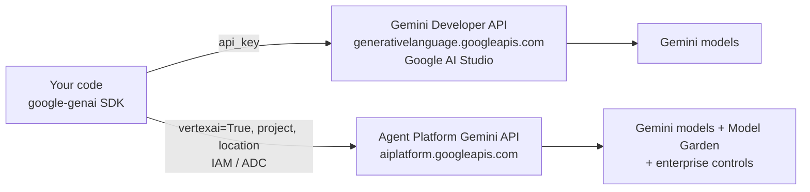

| | Gemini Developer API (Google AI Studio) | Agent Platform (Vertex) Gemini API |
|---|---|---|
| Auth | API key | IAM (ADC, service accounts) |
| Who it's for | Prototyping, startups, consumer apps | Enterprises |
| Data governance | Developer API terms (free tier may use data to improve products; paid tier doesn't) | Enterprise terms: customer data not used to train models; data residency; CMEK; VPC-SC; audit logs |
| Networking | Public endpoint | Regional/global endpoints, PSC, VPC-SC |
| Extras | Fast access to newest previews | Model Garden, tuning, eval, Agent Runtime, RAG Engine, Provisioned Throughput |
| SDK | `google-genai` | `google-genai` with `vertexai=True` |

**At a bank, use Agent Platform.** The same `google-genai` code works for both; only the client constructor changes:

```python
from google import genai

# Developer API (prototype only)
dev = genai.Client(api_key="...")

# Agent Platform (what you'll use at work)
ent = genai.Client(vertexai=True, project="my-project", location="global")
```

Or set environment variables and call `genai.Client()` with no arguments:

```bash
export GOOGLE_GENAI_USE_VERTEXAI=True
export GOOGLE_CLOUD_PROJECT=my-project
export GOOGLE_CLOUD_LOCATION=global
```

ADK reads the same variables. Get used to these three lines; they're in every `.env` you'll write.

**Level 0 check.** You can explain the four Agent Platform pillars, translate any AWS AI service you know into its Google equivalent, decode an old "Vertex AI" name, and explain why enterprise code uses `vertexai=True`.

---

# Level 1: Foundations

## 5. Resource hierarchy, projects and billing

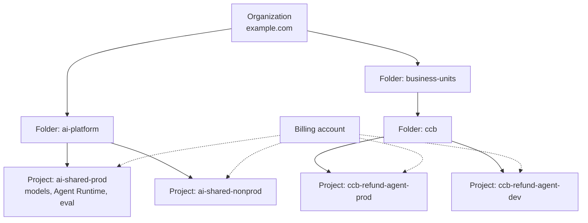

Things that are different from AWS:

- **Everything lives in a project.** Projects have an ID (globally unique, immutable, e.g. `ccb-refund-agent-prod`), a number (used by service agents) and a display name.
- **APIs are off until you enable them.** `gcloud services enable aiplatform.googleapis.com` is the first thing you do. A surprising number of "permission denied" errors are really "API not enabled".
- **Billing accounts** attach to projects. Quotas are mostly **per project per region**, so splitting workloads into projects also splits quota.
- **Labels** on resources flow into billing exports. Label everything with `app`, `env`, `team`, `cost-center`.
- Turn on the **billing export to BigQuery** on day one. That's how you'll answer "how much did the agent cost last week?" with SQL.

APIs you'll enable most often for AI work:

```bash
gcloud services enable \
  aiplatform.googleapis.com \
  discoveryengine.googleapis.com \
  documentai.googleapis.com \
  modelarmor.googleapis.com \
  run.googleapis.com cloudbuild.googleapis.com artifactregistry.googleapis.com \
  bigquery.googleapis.com storage.googleapis.com firestore.googleapis.com \
  secretmanager.googleapis.com cloudtrace.googleapis.com logging.googleapis.com \
  iamcredentials.googleapis.com
```

## 6. IAM for AI engineers

### 6.1 The model

An IAM **policy** is a set of **bindings**: `role` → list of `members`, attached to a **resource** (org, folder, project, or an individual resource like a bucket or an Agent Runtime instance). Policies inherit downward. Members are `user:`, `group:`, `serviceAccount:`, `principal://...` (federated), `domain:`.

The mental shift from AWS: **you don't write JSON policies with actions and ARNs**. You pick predefined roles (bundles of permissions) and bind them at the right level. Custom roles exist for least privilege.

### 6.2 Service accounts and ADC

- Every workload runs as a **service account (SA)**: Cloud Run service, Agent Runtime instance, GKE pod (via Workload Identity), Cloud Build.
- **Never create SA keys.** Use attached SAs in Google Cloud and Workload Identity Federation outside it. Many orgs block key creation with an org policy anyway.
- **Application Default Credentials (ADC)**: client libraries find credentials automatically: attached SA on Google Cloud, `gcloud auth application-default login` on your laptop.
- **Impersonation** for local dev that behaves like prod:

```bash
gcloud auth application-default login \
  --impersonate-service-account=refund-agent@ccb-refund-agent-dev.iam.gserviceaccount.com
```

- **Service agents** are Google-managed SAs that services use on your behalf (e.g. `service-<PROJECT_NUMBER>@gcp-sa-aiplatform.iam.gserviceaccount.com` for Agent Platform, `...@gcp-sa-aiplatform-re.iam.gserviceaccount.com` for Agent Runtime, `...@gcp-sa-discoveryengine...` for Agent Search). When an AI service can't read your bucket, it's usually the **service agent** that needs the grant, not your SA.

### 6.3 Roles you'll use constantly

| Role | What it allows | Typical holder |
|---|---|---|
| `roles/aiplatform.user` | Call models, use most Agent Platform features | App and agent SAs, developers |
| `roles/aiplatform.admin` | Manage everything in Agent Platform | Platform admins only |
| `roles/aiplatform.viewer` | Read-only | Auditors |
| `roles/discoveryengine.editor` / `.viewer` | Manage / query Agent Search, Ranking API | Ingestion SA / retrieval SA |
| `roles/documentai.apiUser` | Process documents | Ingestion SA |
| `roles/modelarmor.user` | Call sanitize APIs | Agent SA |
| `roles/run.invoker` | Call a private Cloud Run service | Agents calling MCP servers |
| `roles/storage.objectViewer` / `objectCreator` | Read / write GCS | Pipelines |
| `roles/bigquery.dataViewer` + `roles/bigquery.jobUser` | Query BigQuery | Data agents |
| `roles/secretmanager.secretAccessor` | Read secrets | Anything with API keys for third parties |
| `roles/iam.serviceAccountUser` | Act as / attach an SA when deploying | CI/CD |
| `roles/iam.serviceAccountTokenCreator` | Impersonate an SA | Developers, CI/CD |

`aiplatform.user` is broad. For production, consider custom roles with only `aiplatform.endpoints.predict` (model calls) plus whatever else the workload truly needs.

### 6.4 Workload Identity Federation for CI/CD

GitHub Actions → Google Cloud without keys:

```yaml
- uses: google-github-actions/auth@v2
  with:
    workload_identity_provider: projects/123456789/locations/global/workloadIdentityPools/github/providers/my-repo
    service_account: deployer@ccb-refund-agent-dev.iam.gserviceaccount.com
- uses: google-github-actions/setup-gcloud@v2
- run: gcloud run deploy ...
```

## 7. Locations, the global endpoint and data residency

Three kinds of location show up in AI services:

| Location type | Example | Used by |
|---|---|---|
| Region | `us-central1`, `us-east4`, `europe-west4` | Most services: Agent Runtime, endpoints, Vector Search, RAG Engine, Cloud Run |
| Multi-region | `us`, `eu` | Agent Search (Discovery Engine), Document AI, some BigQuery datasets |
| **Global** | `global` | Gemini model calls through the **global endpoint**: requests can be served from any region with capacity |

The global endpoint gives you higher availability and fewer 429s for Gemini, at the cost of not pinning *where* inference runs. If your data must be processed in a specific region or jurisdiction, call a **regional endpoint** and read Google's data residency and ML-processing commitments for that model. Not every model is available in every region, and new models often land in `global` and `us-central1` first.

A practical default for a US bank: Gemini calls on a regional US endpoint (or the global endpoint if compliance agrees), Agent Runtime and data in one US region (often `us-central1` or `us-east4`), Agent Search in the `us` multi-region.

## 8. Networking you actually need

You don't need to become a network engineer, but you need these five:

1. **Private Google Access** on subnets so VMs/pods without public IPs can reach Google APIs.
2. **Private Service Connect (PSC)**: a private IP in your VPC for Google APIs (or a specific service like a Vector Search endpoint or Agent Runtime with PSC interface).
3. **VPC Service Controls (VPC-SC)**: a perimeter around projects that stops data leaving via Google APIs, even with valid credentials from outside. In regulated orgs, your AI projects will almost certainly sit inside a perimeter. When something mysteriously fails with "Request is prohibited by organization's policy", it's VPC-SC. Use dry-run mode when you change perimeters.
4. **Cloud Run Direct VPC egress** so your agents reach private databases and PSC endpoints.
5. **Cloud NAT** only if workloads truly need the public internet (third-party APIs). Agents that call arbitrary URLs are a data-exfiltration path; restrict egress.

## 9. Quotas and capacity: DSQ, Provisioned Throughput, batch

How Gemini capacity works on Agent Platform is different from Bedrock's per-model TPM quotas:

| Mode | What it is | When |
|---|---|---|
| **Dynamic shared quota (DSQ)** / pay-as-you-go | No fixed per-project quota for most Gemini models; you share a large pool. Under contention you can get 429s. | Default for development and most production |
| **Provisioned Throughput (PT)** | Reserved capacity (in "generative AI scale units"), billed for a term | Latency-sensitive, high-volume production; your customer-facing agents |
| **Batch prediction** | Async jobs from GCS/BigQuery, discounted, separate capacity | Offline processing, evals, backfills, embeddings |
| **Priority / flex tiers** | Some models offer cheaper lower-priority or higher-priority processing options | Check current docs for availability |

What this means in code: **always retry 429 and 503 with exponential backoff and jitter**. The SDK has retry options (`http_options`), and ADK has retry settings on model calls. For predictable latency in a customer-facing app, size and buy PT for the main model and keep DSQ for overflow.

Other quotas still exist and are per project/region: embedding requests per minute, tuning jobs, Agent Runtime instances, Vector Search, Document AI. Check **IAM & Admin → Quotas** and request increases before launches.

## 10. Your toolbox: gcloud, SDKs, IDEs, notebooks, starter kits

| Tool | Use it for |
|---|---|
| `gcloud` CLI | Everything administrative; `gcloud ai ...`, `gcloud run ...`, `gcloud storage ...` |
| Cloud Shell | Browser terminal with gcloud and auth pre-configured |
| `google-genai` (Python, TS/JS, Go, Java) | Calling Gemini and other models |
| `google-cloud-aiplatform` (with `vertexai` module) | Agent Runtime, RAG Engine, evaluation, tuning, endpoints (some parts migrating to new clients) |
| `google-adk` | Building agents |
| `google-cloud-discoveryengine` | Agent Search, Ranking API, Check Grounding |
| Colab Enterprise | Managed notebooks inside your project with your IAM and VPC-SC |
| Workbench | JupyterLab instances (more control, longer-running) |
| **Agent Starter Pack** | Open-source templates that scaffold a production agent project: ADK/LangGraph agent, FastAPI, Terraform, CI/CD (Cloud Build or GitHub Actions), evaluation, observability. Best way to start a new agent repo. |
| Gemini CLI | Terminal coding agent (open source), with MCP support and Google Cloud extensions |
| Gemini Code Assist | IDE assistant (VS Code, JetBrains) with enterprise controls |
| Antigravity | Google's agentic IDE |
| **Data Agent Kit** | Portable skills/tools/plugins that put BigQuery and data agents inside VS Code, Gemini CLI, Codex or Claude Code (preview at launch) |

Local setup in five commands:

```bash
gcloud auth login
gcloud config set project ccb-refund-agent-dev
gcloud auth application-default login
python -m venv .venv && source .venv/bin/activate
pip install google-genai google-adk google-cloud-aiplatform
```

**Level 1 check.** You can create a project, enable APIs, attach a least-privilege service account to a workload, run locally with impersonation, explain DSQ vs Provisioned Throughput, and recognize a VPC-SC denial when you see one.

---

# Level 2: Models

## 11. The Gemini model family

### 11.1 Tiers

Google ships Gemini in tiers and iterates on them very quickly (new Flash versions every few weeks in 2026). Think in tiers, pin versions in config.

| Tier | What it's for | Role in an agent system |
|---|---|---|
| **Pro** | Strongest reasoning, coding, long multi-step tasks | Final answer writer for hard questions, complex planning |
| **Flash** | Fast, cheap, very capable; Google's "workhorse" | Default for agents: tool calling, RAG answers, most production traffic |
| **Flash-Lite** | Cheapest, fastest, high volume | Routing, classification, extraction, grading, guard checks |
| **Live / native audio** | Real-time bidirectional audio/video | Voice agents |
| **Image (Gemini image models), Imagen** | Image generation and editing | Creative and document workflows |
| **Embedding** | Text and multimodal embeddings | Retrieval |
| Specialized variants | e.g. security-tuned or computer-use models | Specific use cases, sometimes restricted access |

### 11.2 The lineup as of late 2026

The 2026 cadence was unusual. Gemini 3 Pro launched in November 2025 and got one update (3.1 Pro, February 2026). At I/O in May 2026 Google launched **Gemini 3.5 Flash** and promised 3.5 Pro the following month. Instead, it shipped **Gemini 3.6 Flash**, **3.5 Flash-Lite** and a security-specialized **3.5 Flash Cyber** in July, and **Gemini 3.7 Flash** in August. Google later said it would **not** release 3.5 Pro and moved straight to **Gemini 4** as the next flagship.

Practical guidance:

- **Look up current model IDs in the Agent Platform model docs or Model Garden** the week you build. Don't copy IDs from blog posts (including this guide).
- Prefer **GA** versions for production. Previews can change behavior and get retired quickly.
- Every model version has a **retirement date**. Put model IDs in config, track retirement dates, and re-run evals before switching.
- The newest Flash is often the right default for agents. Use Pro (or Gemini 4 once available on Agent Platform in your region) for the hard tail, chosen by your eval results, not by benchmark headlines.

### 11.3 Capabilities you'll rely on

| Capability | Notes |
|---|---|
| Long context | 1M-token class context windows on current Pro/Flash models |
| Multimodal input | Text, images, PDFs, audio, video, mixed in one request |
| Thinking | Models reason before answering. Newer models control it with a **thinking level** (e.g. low/high); older 2.5-era models used a **thinking budget** in tokens. Lower thinking = lower latency and cost. |
| Function calling | Parallel calls, forced modes (`AUTO`, `ANY`, `NONE`, validated) |
| Structured output | JSON schema / Pydantic, enforced |
| Built-in tools | Google Search grounding, URL context, code execution, enterprise grounding |
| Context caching | Implicit (automatic) and explicit caches |
| Live API | Bidirectional streaming over WebSocket for voice/video |

## 12. The Gen AI SDK in depth

`google-genai` is the one SDK for Gemini (and other Google generative models) across both doors. Everything below assumes the enterprise client:

```python
from google import genai
from google.genai import types

client = genai.Client(vertexai=True, project="ccb-refund-agent-dev", location="global")
MODEL = "<gemini-flash-model-id>"      # from config
```

### 12.1 Basics, system instructions, generation config

```python
resp = client.models.generate_content(
    model=MODEL,
    contents="Summarize the refund rules for overdraft fees in three bullets.",
    config=types.GenerateContentConfig(
        system_instruction="You are a precise assistant for bank operations staff.",
        temperature=0.2,
        max_output_tokens=1024,
        thinking_config=types.ThinkingConfig(thinking_level="low"),   # newer models; older used thinking_budget
    ),
)
print(resp.text)
print(resp.usage_metadata)        # prompt, candidates, thoughts, cached token counts
```

### 12.2 Streaming and chat

```python
for chunk in client.models.generate_content_stream(model=MODEL, contents="Explain Reg E in plain English."):
    print(chunk.text or "", end="", flush=True)

chat = client.chats.create(model=MODEL, config=types.GenerateContentConfig(temperature=0))
chat.send_message("A customer was charged an overdraft fee 45 days ago.")
print(chat.send_message("Can we refund it?").text)
```

Async versions live under `client.aio` (`await client.aio.models.generate_content(...)`). Use them in FastAPI and ADK.

### 12.3 Structured output

```python
from pydantic import BaseModel, Field

class RefundDecision(BaseModel):
    eligible: bool
    reason: str
    policy_section: str = Field(description="Section number of the policy that applies")
    requires_manager_approval: bool

resp = client.models.generate_content(
    model=MODEL,
    contents=f"Policy:\n{policy_text}\n\nCase:\n{case_text}",
    config=types.GenerateContentConfig(
        response_mime_type="application/json",
        response_schema=RefundDecision,
        temperature=0,
    ),
)
decision: RefundDecision = resp.parsed
```

### 12.4 Function calling (manual and automatic)

The SDK can run Python functions for you (**automatic function calling**), which is handy for scripts. In agents, ADK handles the loop.

```python
def get_fee_history(account_id: str, days: int = 90) -> dict:
    """Return fees charged on the account in the last N days."""
    return {"fees": [{"type": "overdraft", "amount": 35.0, "date": "2026-09-27"}]}

resp = client.models.generate_content(
    model=MODEL,
    contents="What fees were charged on account 991-22 recently?",
    config=types.GenerateContentConfig(tools=[get_fee_history]),   # SDK calls it and loops
)
print(resp.text)
```

Manual control (what you want when you need auditing, approval or custom execution):

```python
config = types.GenerateContentConfig(
    tools=[get_fee_history],
    automatic_function_calling=types.AutomaticFunctionCallingConfig(disable=True),
    tool_config=types.ToolConfig(function_calling_config=types.FunctionCallingConfig(mode="AUTO")),
)
resp = client.models.generate_content(model=MODEL, contents="...", config=config)
for call in resp.function_calls or []:
    result = dispatch(call.name, call.args)            # your executor
    # send back: types.Part.from_function_response(name=call.name, response=result)
```

Modes: `AUTO` (model decides), `ANY` (must call a function, optionally from `allowed_function_names`), `NONE` (no calls), and a validated mode on newer models that constrains output to valid calls.

### 12.5 Multimodal inputs

```python
resp = client.models.generate_content(
    model=MODEL,
    contents=[
        types.Part.from_uri(file_uri="gs://kb-raw-dev/statements/2026-09.pdf", mime_type="application/pdf"),
        types.Part.from_uri(file_uri="gs://kb-raw-dev/calls/call-8812.mp3", mime_type="audio/mpeg"),
        "Does the customer's complaint in the call match a fee on the statement? Quote both.",
    ],
)
```

`gs://` URIs are read by the **Agent Platform service agent**, so grant it `storage.objectViewer` on the bucket (or use `Part.from_bytes` with data you've already loaded). Video supports clipping (`video_metadata` with start/end offsets) and frame rate settings.

### 12.6 Tokens, safety, metadata

```python
client.models.count_tokens(model=MODEL, contents=long_prompt)   # before you send

config = types.GenerateContentConfig(
    safety_settings=[
        types.SafetySetting(category="HARM_CATEGORY_DANGEROUS_CONTENT", threshold="BLOCK_MEDIUM_AND_ABOVE"),
    ],
)
# resp.candidates[0].finish_reason tells you if output was blocked (SAFETY), cut (MAX_TOKENS), etc.
```

Always check `finish_reason`. An empty `resp.text` with `finish_reason=SAFETY` is a classic surprise in banking text (fraud, debt, disputes can trip filters); tune safety settings deliberately and pair them with Model Armor for policy enforcement (section 34).

### 12.7 Retries and timeouts

```python
client = genai.Client(
    vertexai=True, project="...", location="global",
    http_options=types.HttpOptions(
        timeout=120_000,                        # ms
        retry_options=types.HttpRetryOptions(attempts=5, initial_delay=1.0, max_delay=30.0,
                                             exp_base=2.0, jitter=1.0, http_status_codes=[429, 503]),
    ),
)
```

(Check the field names against your SDK version; retry options were added in 2025 and have evolved.)

## 13. Built-in tools and grounding

Gemini can call Google-run tools without you writing them. They run server-side.

| Tool | What it does | Notes |
|---|---|---|
| **Google Search grounding** | Searches the web, grounds the answer, returns sources | You must display Search suggestions/attributions per terms; billed per grounded request |
| **Enterprise web search** | Web grounding with enterprise-oriented data handling | Check availability; designed for regulated customers |
| **URL context** | Fetches and reads URLs you put in the prompt | Good for "compare these pages" |
| **Code execution** | Model writes and runs Python in a sandbox | Calculations, data wrangling |
| **Grounding with Agent Search** | Grounds on your Agent Search data store | Private enterprise RAG with no retrieval code |
| **RAG Engine retrieval** | Grounds on a RAG Engine corpus | Managed RAG |
| **Google Maps grounding** | Places and geo facts | Location use cases |

```python
search = types.Tool(google_search=types.GoogleSearch())
url_ctx = types.Tool(url_context=types.UrlContext())
code = types.Tool(code_execution=types.ToolCodeExecution())

enterprise_rag = types.Tool(retrieval=types.Retrieval(
    vertex_ai_search=types.VertexAISearch(
        datastore="projects/p/locations/us/collections/default_collection/dataStores/ccb-policies")))

rag_engine = types.Tool(retrieval=types.Retrieval(
    vertex_rag_store=types.VertexRagStore(
        rag_resources=[types.VertexRagStoreRagResource(
            rag_corpus="projects/p/locations/us-central1/ragCorpora/123")],
        similarity_top_k=8)))

resp = client.models.generate_content(
    model=MODEL, contents="What does our policy say about refunding overdraft fees after 30 days?",
    config=types.GenerateContentConfig(tools=[enterprise_rag]))
meta = resp.candidates[0].grounding_metadata      # chunks, supports (which text spans map to which sources)
```

`grounding_metadata.grounding_supports` maps answer text segments to source chunks: that's your citation data, already computed.

Rules of thumb:

- For **public web facts**, Google Search grounding is excellent. For a bank's internal assistant, it's usually **off** unless compliance approves web grounding.
- Some built-in tools can't be combined with arbitrary function declarations in the same request on some models. In ADK the workaround is to wrap the built-in-tool agent as an `AgentTool` (section 24).

## 14. Caching, batch, Live API and media models

### 14.1 Context caching

- **Implicit caching**: automatic on recent Gemini models when requests share a long prefix. Put stable content (system prompt, tool definitions, big reference docs) at the **start** of the prompt so the cache hits. `usage_metadata.cached_content_token_count` tells you it worked.
- **Explicit caching**: you create a cache with a TTL and reference it. Use for large, reused context (a 300-page policy manual that every request needs).

```python
cache = client.caches.create(
    model=MODEL,
    config=types.CreateCachedContentConfig(
        display_name="fee-policy-2026",
        system_instruction="Answer only from the policy manual.",
        contents=[types.Part.from_uri(file_uri="gs://kb/policies/fee-manual.pdf", mime_type="application/pdf")],
        ttl="3600s",
    ),
)
resp = client.models.generate_content(model=MODEL, contents="Exceptions to the 30-day window?",
                                      config=types.GenerateContentConfig(cached_content=cache.name))
```

### 14.2 Batch prediction

```python
job = client.batches.create(
    model=MODEL,
    src="gs://ai-batch/in/complaints-2026-11.jsonl",       # or bq://project.dataset.table
    config=types.CreateBatchJobConfig(dest="gs://ai-batch/out/"),
)
# poll client.batches.get(name=job.name) until JOB_STATE_SUCCEEDED
```

Each JSONL line is a request (`{"request": {"contents": [...], "generationConfig": {...}}}`). Batch is discounted versus online and doesn't consume your online capacity. Use it for classifying a million complaints, generating eval answers, or embedding backfills.

### 14.3 Live API (real-time voice and video)

The Live API keeps a WebSocket session open for low-latency, interruptible, bidirectional audio (and video) with tool calling. It's what you'd use to build a voice agent in code (CX Agent Studio is the managed product route; section 32).

```python
async with client.aio.live.connect(
    model="<gemini-live-model-id>",
    config=types.LiveConnectConfig(
        response_modalities=["AUDIO"],
        system_instruction="You are a polite bank assistant. Keep answers short.",
        tools=[get_fee_history],
        speech_config=types.SpeechConfig(language_code="en-US"),
    ),
) as session:
    await session.send_realtime_input(audio=types.Blob(data=pcm_chunk, mime_type="audio/pcm;rate=16000"))
    async for msg in session.receive():
        if msg.data:               # audio bytes to play
            play(msg.data)
        if msg.tool_call:          # run tools, then session.send_tool_response(...)
            ...
```

Key concepts: voice activity detection (automatic or manual), barge-in/interruptions, session resumption, context window compression for long calls, input/output transcription. ADK wraps all of this with `runner.run_live(...)`.

### 14.4 Media models

| Need | Model family | SDK call |
|---|---|---|
| Image generation / editing | Gemini image models, Imagen | `generate_content` with image output, or `generate_images` / `edit_image` |
| Video generation | Veo | `generate_videos` (long-running operation) |
| Speech-to-text | Chirp (Speech-to-Text v2), Gemini audio understanding | Speech API / `generate_content` with audio |
| Text-to-speech | Text-to-Speech (Chirp HD voices), Gemini TTS | TTS API / `generate_content` with audio output |
| Music | Lyria | Agent Platform |

## 15. Model Garden: Claude, Llama, Gemma and open models

Model Garden is the catalog: 200+ models in three groups.

| Group | Examples | How you use them |
|---|---|---|
| Google first-party | Gemini, Imagen, Veo, Chirp, embeddings | Gen AI SDK |
| **Partner models as a service (MaaS)** | Anthropic Claude, Mistral, Meta Llama (MaaS), AI21, others | Serverless, pay per token, partner SDK or REST; no infra |
| **Open models, self-deployed** | Gemma, Llama, Qwen, DeepSeek, Mistral open weights, Hugging Face models | One-click deploy to an Agent Platform endpoint (often vLLM-based containers) or to GKE |

### 15.1 Claude on Agent Platform

```python
from anthropic import AnthropicVertex

claude = AnthropicVertex(project_id="ccb-refund-agent-dev", region="global")
msg = claude.messages.create(
    model="<claude-model-id-from-model-garden>",
    max_tokens=1024,
    messages=[{"role": "user", "content": "Draft a customer letter explaining the refund decision."}],
)
print(msg.content[0].text)
```

You enable each partner model once in Model Garden (accept terms), grant `aiplatform.user`, and bill through Google Cloud. In ADK, use Claude via `LiteLlm(model="vertex_ai/<claude-model-id>")` or ADK's Claude integration.

### 15.2 Open models

- **Gemma** (Google's open-weight family) is the natural small model for on-prem/edge, fine-tuning and private serving.
- Deploy from Model Garden to an endpoint with a vLLM container, choose GPU type and replicas; you get an OpenAI-compatible or Agent Platform prediction API.
- For full control and cost efficiency at scale, deploy the same containers on **GKE** (section 17).

## 16. Customizing models: prompts, tuning, distillation

### 16.1 Order of operations

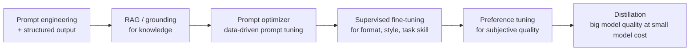

Same as on AWS: **don't tune for knowledge** (use retrieval), tune for **behavior** (format, tone, classification accuracy, tool-call reliability on your schema).

### 16.2 Prompt management and optimizer

- Agent Platform has prompt management (save, version, share prompts) and a **prompt optimizer** that rewrites system instructions using a labeled dataset and an evaluation metric. It's useful when porting prompts written for another model family; prompts written for Claude or GPT often need adjustment for Gemini.
- **Agent Optimizer** (section 36) does something similar for whole agents using real failure clusters.

### 16.3 Supervised fine-tuning (SFT) for Gemini

Training data (JSONL, one example per line):

```json
{"systemInstruction": {"role": "system", "parts": [{"text": "Classify the complaint."}]},
 "contents": [
   {"role": "user", "parts": [{"text": "I was charged twice for the same overdraft..."}]},
   {"role": "model", "parts": [{"text": "{\"category\": \"duplicate_fee\", \"product\": \"checking\"}"}]}
 ]}
```

```python
job = client.tunings.tune(
    base_model="<tunable-gemini-model-id>",
    training_dataset=types.TuningDataset(gcs_uri="gs://ai-tuning/complaints/train.jsonl"),
    config=types.CreateTuningJobConfig(
        tuned_model_display_name="complaint-classifier-v3",
        epoch_count=3,
        validation_dataset=types.TuningDataset(gcs_uri="gs://ai-tuning/complaints/val.jsonl"),
    ),
)
# poll client.tunings.get(name=job.name); then call job.tuned_model.endpoint as the model
```

The tuned model is served behind its own endpoint, priced like the base model (check current pricing for tuned-model serving). Typical sizes: a few hundred to a few thousand high-quality examples beat tens of thousands of noisy ones.

### 16.4 Other options

- **Preference tuning** (pairs of preferred/rejected responses) for tone and subjective quality.
- **Distillation** from a large Gemini model to a smaller one for a specific task.
- **Open models**: LoRA/QLoRA fine-tuning with custom training jobs or on GKE, then serve with vLLM.

## 17. Serving your own models: endpoints, GKE, Cloud Run GPUs

| Option | Feels like | Use when |
|---|---|---|
| **Agent Platform endpoints** (online prediction) | SageMaker real-time endpoints | Managed serving with autoscaling, model registry integration, private endpoints; Model Garden deploys here |
| **GKE** with vLLM / TGI / SGLang, **GKE Inference Gateway**, TPU or GPU node pools | EKS + your own serving | High scale, cost control, custom routing (KV-cache-aware, LoRA multiplexing) |
| **Cloud Run with GPUs** | Fargate with GPUs | Small/medium models, bursty traffic, scale to zero |
| **Batch prediction** on your model | SageMaker batch transform | Offline scoring |

Model Registry tracks versions; endpoints can split traffic between versions (canary). For TPUs, JetStream and vLLM TPU support exist for serving open models efficiently.

**Level 2 check.** You can call Gemini with structured output and tools through the Gen AI SDK, ground on Google Search or your own data store, use caching and batch, call Claude on Agent Platform, decide when to tune, and pick a serving option for an open model.

---

# Level 3: Data and retrieval

The RAG pipeline itself (events, Workflows, Cloud Tasks, Vector Search, registry, hybrid retrieval tool) is covered end to end in `GCP_DeepDive.md`. This level gives you the map so you can choose well.

## 18. Embeddings

| Model | Notes |
|---|---|
| **Gemini Embedding** (`gemini-embedding-001`) and **Gemini Embedding 2** | Top-quality text embeddings; Matryoshka (choose output dimensionality, e.g. 768/1536/3072); multilingual; Gemini Embedding 2 went GA in 2026 (check its modality support and ID) |
| `text-embedding-005` | Cheaper English/code model, 768 dims |
| `text-multilingual-embedding-002` | Older multilingual |
| `multimodalembedding` | Image + text in one space |

```python
r = client.models.embed_content(
    model="gemini-embedding-001",
    contents=["Overdraft fees may be refunded within 30 days..."],
    config=types.EmbedContentConfig(task_type="RETRIEVAL_DOCUMENT", output_dimensionality=768,
                                    title="Fee Policy 2026 > Refunds"),
)
vec = r.embeddings[0].values
```

Remember: `RETRIEVAL_DOCUMENT` for chunks, `RETRIEVAL_QUERY` for queries, and **L2-normalize truncated vectors** yourself.

## 19. Choosing a retrieval backend

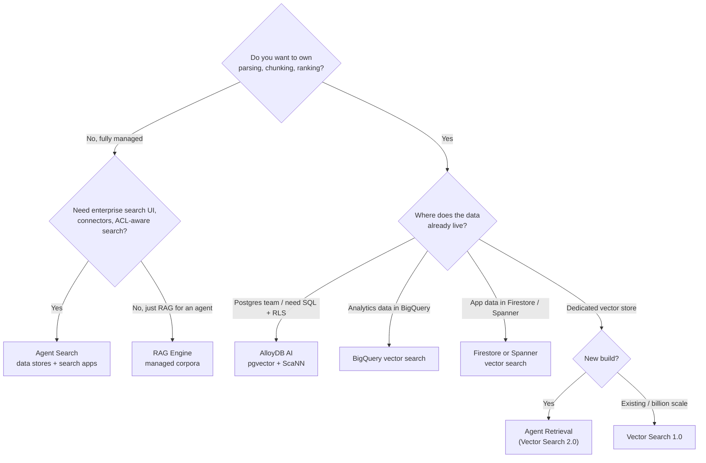

| Backend | Stores text? | Hybrid | ACL model | Ops | Best for |
|---|---|---|---|---|---|
| **Agent Search** | Yes | Yes (Google ranking) | Document-level ACLs for connector sources; filters | None | Enterprise search + RAG with minimal code |
| **RAG Engine** | Yes | Depends on backend | Corpus-level, metadata filters | Low | Managed RAG for agents |
| **Agent Retrieval** | Yes | Built in (RRF) | Metadata filters | Low | New custom RAG builds |
| **Vector Search 1.0** | No (IDs + restricts) | Dense + your sparse vectors | Restricts (token allow/deny) | Medium (endpoints) | Very large scale, existing deployments |
| **AlloyDB AI** | Yes | SQL + RRF | Postgres RLS | Medium | Postgres shops, transactional joins |
| **BigQuery** | Yes | Vector + SQL | BigQuery row-level security | None | Analytics-style retrieval, evals, dedupe |
| **Firestore / Spanner / Memorystore** | Yes | Limited | App/DB level | Low | App-embedded vector lookups, semantic caches |

My default for a new agentic RAG system on Google Cloud: **custom ingestion → Agent Retrieval or AlloyDB AI**, with Agent Search for use cases that are really "search over SharePoint/Drive/Confluence with permissions".

## 20. Document AI and parsing

| Processor | Use |
|---|---|
| Enterprise Document OCR | Text from scans |
| **Layout Parser** | Structure (headings, tables, lists) + built-in chunking; the default for RAG |
| Form Parser | Key-value pairs |
| Custom extractors (generative) | Extract fields you define, trained with few examples |
| Specialized processors | Invoices, IDs, bank statements, lending documents (availability varies) |

Online processing for small docs, **batch** for large ones. Gemini itself is a strong parser for ugly layouts (send the PDF, ask for Markdown). Docling remains a great open-source option on Cloud Run jobs. Details and code: `GCP_DeepDive.md` section 10.

## 21. Ranking and grounding-check APIs

Both live in the Discovery Engine (Agent Search) API family and are useful even if you don't use Agent Search.

- **Ranking API**: semantic reranker for (query, records) pairs; drop-in replacement for a cross-encoder. Pin a model version in prod.
- **Check Grounding API**: given an answer and a set of facts, returns a support score and per-claim citations. Use it as the "is this answer supported?" step in agentic RAG.

```python
from google.cloud import discoveryengine_v1 as de

grounding = de.GroundedGenerationServiceClient()
res = grounding.check_grounding(request=de.CheckGroundingRequest(
    grounding_config=f"projects/{PROJECT}/locations/global/groundingConfigs/default_grounding_config",
    answer_candidate=answer_text,
    facts=[de.GroundingFact(fact_text=p["text"], attributes={"source": p["source_uri"]}) for p in passages],
    grounding_spec=de.CheckGroundingSpec(citation_threshold=0.6),
))
print(res.support_score)        # 0..1; regenerate or caveat below your threshold
```

## 22. BigQuery as an AI engine (and the rest of the data platform)

BigQuery is more central on Google Cloud than Redshift is on AWS. For AI engineers it's three things:

1. **An AI runtime in SQL.** Call Gemini and other models over rows without moving data.
2. **A vector store** for analytics-style retrieval, evaluation and deduplication.
3. **The place your logs, evals, billing and agent traces end up** for analysis.

### 22.1 Gemini in SQL

BigQuery has generative AI functions (the `AI.*` family, e.g. `AI.GENERATE`, `AI.GENERATE_TABLE`, typed variants like `AI.GENERATE_BOOL`, plus the older `ML.GENERATE_TEXT`) and embedding functions (`ML.GENERATE_EMBEDDING`, `AI.GENERATE_EMBEDDING`), backed by a connection to Agent Platform or by built-in model access.

```sql
-- Classify complaints with Gemini, row by row, entirely in BigQuery
SELECT
  complaint_id,
  AI.GENERATE(
    ('Classify this banking complaint into one of: duplicate_fee, overdraft, dispute, other. ',
     'Return only the label. Complaint: ', complaint_text),
    connection_id => 'us.ai_conn',
    endpoint => '<gemini-flash-model-id>'
  ).result AS category
FROM `ccb.complaints.raw_2026_11`
LIMIT 1000;
```

```sql
-- Embed and search
CREATE OR REPLACE TABLE kb.chunks_emb AS
SELECT * FROM ML.GENERATE_EMBEDDING(
  MODEL `kb.gemini_embed`,
  (SELECT chunk_id, content FROM kb.chunks),
  STRUCT('RETRIEVAL_DOCUMENT' AS task_type, 768 AS output_dimensionality));

SELECT base.chunk_id, distance
FROM VECTOR_SEARCH(TABLE kb.chunks_emb, 'ml_generate_embedding_result',
  (SELECT ml_generate_embedding_result FROM ML.GENERATE_EMBEDDING(MODEL `kb.gemini_embed`,
     (SELECT 'refund overdraft fee after 30 days' AS content),
     STRUCT('RETRIEVAL_QUERY' AS task_type, 768 AS output_dimensionality))),
  top_k => 10, distance_type => 'COSINE');
```

(Function names and signatures in the `AI.*` family have evolved quickly; check the BigQuery generative AI reference for your project.)

### 22.2 Data agents

- **Conversational analytics / data agents** in BigQuery let users ask questions in natural language over curated datasets.
- The **BigQuery managed MCP server** exposes SQL execution and metadata to any MCP-capable agent (section 28).
- **Data Agent Kit** brings data skills into editors (VS Code, Gemini CLI, Claude Code).

### 22.3 The rest of the data platform, briefly

| Service | AI engineering use |
|---|---|
| Pub/Sub | Event backbone for ingestion and agent triggers |
| Dataflow (Apache Beam) | Streaming/batch pipelines, including calling models inside pipelines (RunInference) |
| Dataproc / Managed Service for Apache Spark, Serverless Spark | Your Spark/PySpark skills transfer directly |
| Managed Service for Apache Kafka | Kafka without ops |
| Cloud Composer | Managed Airflow |
| Dataplex / catalog | Metadata, lineage, data quality; feeds governance for data agents |
| Feature Store | Features served from BigQuery for ML models |

**Level 3 check.** You can choose a retrieval backend with reasons, embed correctly, rerank and check grounding with Google APIs, and run Gemini over a BigQuery table.

---

# Level 4: Agents

## 23. Gemini Enterprise Agent Platform: the map

Google organized the agent tooling around four pillars when it launched the platform at Next '26.

```mermaid
flowchart LR
    subgraph B["Build"]
        ADK["ADK<br/>code-first, Python / Java / Go / TS"]
        ASTU["Agent Studio<br/>low-code, exports to ADK"]
        ADES["Agent Designer"]
        AGAR["Agent Garden<br/>samples and templates"]
        DAK["Data Agent Kit<br/>editor plugins"]
    end
    subgraph S["Scale"]
        ART["Agent Runtime<br/>managed, long-running agents"]
        SES["Sessions"]
        MB["Memory Bank<br/>Memory Profiles"]
        SBX["Code execution sandbox"]
    end
    subgraph G["Govern"]
        AID["Agent Identity"]
        AREG["Agent Registry<br/>agents, MCP servers, tools"]
        AGW["Agent Gateway<br/>MCP + A2A aware"]
        MA["Model Armor"]
    end
    subgraph O["Optimize"]
        AEV["Agent Evaluation"]
        ASIM["Agent Simulation"]
        AOBS["Agent Observability"]
        AOPT["Agent Optimizer"]
    end
    B --> S --> G --> O
    O -. "feedback" .-> B
```

| Pillar | Component | One-line description | AWS analogue |
|---|---|---|---|
| Build | **ADK** | Open-source, code-first agent framework | Strands |
| Build | **Agent Studio** | Low-code builder; export to ADK when logic outgrows it | Bedrock Agents console |
| Build | Agent Designer | Visual design of agents/flows | (none exact) |
| Build | Agent Garden | Sample agents and tools | AgentCore samples |
| Scale | **Agent Runtime** | Managed runtime; fast cold starts; agents that keep state for days | AgentCore Runtime |
| Scale | Sessions | Managed conversation state | AgentCore Memory (short-term) |
| Scale | **Memory Bank** | Long-term memories generated from conversations; Memory Profiles | AgentCore Memory (long-term) |
| Govern | **Agent Identity** | Unique cryptographic identities for agents | AgentCore Identity |
| Govern | **Agent Registry** | Catalog of agents, MCP servers and tools | AWS Agent Registry |
| Govern | **Agent Gateway** | Protocol-aware gateway for MCP and A2A traffic with policy | AgentCore Gateway + Policy |
| Optimize | Agent Evaluation | Evaluate agents (trajectories, responses) | AgentCore Evaluations |
| Optimize | **Agent Simulation** | Synthetic users + virtualized tools to test agents before launch | (none exact) |
| Optimize | Agent Observability | Traces of agent reasoning and tool calls | AgentCore Observability |
| Optimize | **Agent Optimizer** | Clusters real failures and suggests better system instructions | (none exact) |

## 24. ADK from zero to hero

ADK (Agent Development Kit) is Google's open-source agent framework. It's the thing you'll write every day. It's model-agnostic (Gemini natively, anything else via LiteLLM), deployment-agnostic (Agent Runtime, Cloud Run, GKE, your laptop), and available in Python, Java, Go and TypeScript. The 2026 releases added a graph-based way to compose agents and sub-agents.

### 24.1 Core concepts

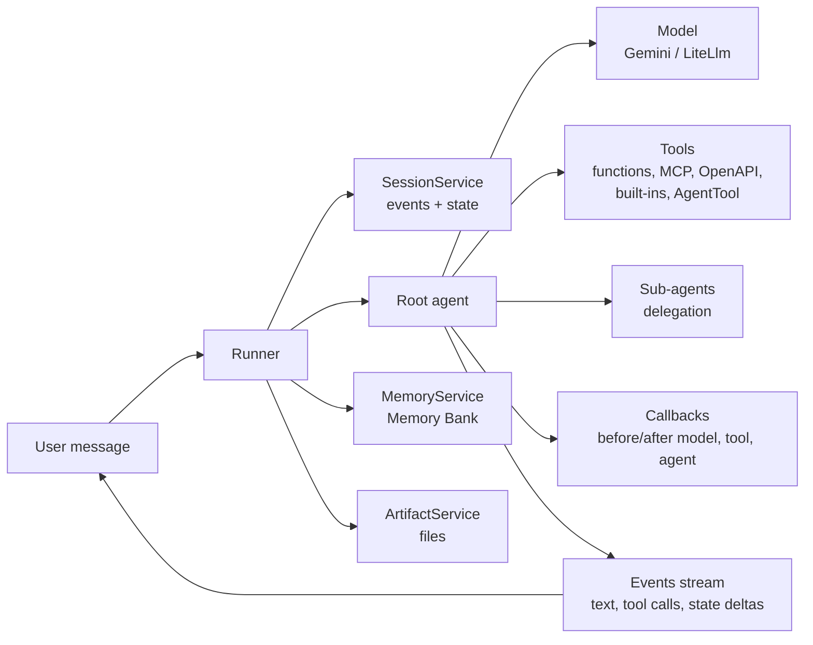

| Concept | What it is | LangGraph / Strands analogue |
|---|---|---|
| `Agent` (`LlmAgent`) | Model + instruction + tools + optional sub-agents | Agent / node |
| Workflow agents | `SequentialAgent`, `ParallelAgent`, `LoopAgent`: deterministic orchestration of sub-agents | Graph edges |
| Custom agent | Subclass `BaseAgent`, write `_run_async_impl` | Custom node |
| Tool | Python function, `AgentTool`, MCP, OpenAPI, built-ins | Tool |
| Runner | Executes an agent for a session, yields events | `graph.astream` |
| Session | Conversation: events + **state** dict | Thread + state |
| State scopes | No prefix = session; `user:` = per user across sessions; `app:` = global; `temp:` = this invocation only | Store / config |
| Event | Everything that happens (model text, tool call, tool result, state delta, transfer) | Stream events |
| Callbacks | Hooks around agent, model and tool calls | Middleware / hooks |
| Memory | Long-term, searchable across sessions | Store |
| Artifacts | Named, versioned files (blobs) tied to sessions | (none built in) |

### 24.2 Project layout and first agent

```bash
pip install google-adk
adk create refund_agent        # scaffolds the folder
```

```
refund_agent/
  __init__.py        # from . import agent
  agent.py           # defines root_agent
  .env               # GOOGLE_GENAI_USE_VERTEXAI=TRUE, GOOGLE_CLOUD_PROJECT=..., GOOGLE_CLOUD_LOCATION=...
```

```python
# refund_agent/agent.py
from google.adk.agents import Agent

def get_fee_history(account_id: str, days: int = 90) -> dict:
    """Return fees charged on an account in the last N days.

    Args:
        account_id: The customer's account identifier.
        days: How many days back to look.
    """
    return {"status": "ok", "fees": [{"type": "overdraft", "amount": 35.0, "date": "2026-09-27"}]}

root_agent = Agent(
    name="refund_assistant",
    model="<gemini-flash-model-id>",
    description="Answers fee and refund questions for operations staff.",
    instruction=(
        "You help bank operations staff with fee refunds. "
        "Use get_fee_history to look up fees. Never guess amounts. Be concise."
    ),
    tools=[get_fee_history],
)
```

```bash
adk web          # dev UI at localhost:8000: chat, see events, tool calls, state, traces
adk run refund_agent
adk api_server   # FastAPI server exposing your agents over HTTP
```

ADK builds the tool schema from the **function signature, type hints and docstring**. Good docstrings are your tool descriptions; write them like API docs. Return dicts with a `status` key; models handle structured results better than bare strings.

### 24.3 Running agents in your own code

```python
import asyncio
from google.adk.runners import Runner
from google.adk.sessions import InMemorySessionService
from google.genai import types
from refund_agent.agent import root_agent

async def main():
    sessions = InMemorySessionService()
    runner = Runner(agent=root_agent, app_name="refunds", session_service=sessions)
    s = await sessions.create_session(app_name="refunds", user_id="op-123",
                                      state={"user:verified_groups": ["grp-ccb-ops"]})
    msg = types.Content(role="user", parts=[types.Part(text="Any fees on account 991-22?")])
    async for event in runner.run_async(user_id="op-123", session_id=s.id, new_message=msg):
        if event.get_function_calls():
            print("tool call:", [c.name for c in event.get_function_calls()])
        if event.is_final_response() and event.content:
            print(event.content.parts[0].text)

asyncio.run(main())
```

Session services: `InMemorySessionService` (dev), `DatabaseSessionService` (Postgres/MySQL/SQLite via SQLAlchemy), `VertexAiSessionService` (Agent Runtime sessions).

### 24.4 Tools taxonomy

| Tool type | How | Notes |
|---|---|---|
| Function tool | Plain Python function (sync or async) | Most common |
| `ToolContext` param | Add `tool_context: ToolContext` to a function | Read/write state, save artifacts, request auth, escalate |
| Long-running function | `LongRunningFunctionTool` | Human approval, async jobs |
| **AgentTool** | Wrap another agent as a tool | Use a specialist agent as a callable; also the workaround for built-in tool combination limits |
| Built-ins | `google_search`, code execution, Agent Search tool, RAG Engine retrieval tool | Server-side Google tools |
| **MCPToolset** | Connect to MCP servers (stdio, SSE, streamable HTTP) | Google-managed MCP servers, your FastMCP servers |
| OpenAPI toolset | Generate tools from an OpenAPI spec | Internal REST APIs |
| Application Integration / Apigee tools | Use enterprise connectors and API hub APIs | Salesforce, SAP, ServiceNow, etc. |
| BigQuery / Spanner / database toolsets | First-party toolsets and MCP Toolbox for Databases | Data agents |
| LangChain / CrewAI tools | Adapters | Reuse existing tools |

```python
from google.adk.tools import ToolContext, AgentTool, google_search
from google.adk.tools.mcp_tool.mcp_toolset import MCPToolset
from google.adk.tools.mcp_tool.mcp_session_manager import StreamableHTTPConnectionParams

def open_refund_case(account_id: str, fee_date: str, amount: float, tool_context: ToolContext) -> dict:
    """Open a refund case. Requires manager approval for amounts over 100."""
    groups = tool_context.state.get("user:verified_groups", [])
    if "grp-ccb-ops" not in groups:
        return {"status": "error", "message": "not authorized"}
    tool_context.state["last_case_account"] = account_id      # session-scoped state
    return {"status": "ok", "case_id": "RF-20261111-0042"}

web_researcher = Agent(name="web_researcher", model="<gemini-flash-model-id>",
                       instruction="Search the public web and summarize with sources.",
                       tools=[google_search])

kb_tools = MCPToolset(connection_params=StreamableHTTPConnectionParams(
    url="https://kb-retrieval-xyz-uc.a.run.app/mcp",
    headers={"Authorization": "Bearer <id-token>"}))

root_agent = Agent(
    name="refund_assistant", model="<gemini-flash-model-id>",
    instruction="...",
    tools=[get_fee_history, open_refund_case, kb_tools, AgentTool(agent=web_researcher)],
)
```

### 24.5 Multi-agent patterns

**Delegation (LLM-driven transfer).** A coordinator with `sub_agents`; the model transfers control based on each sub-agent's `description`.

```python
billing = Agent(name="billing_agent", model=FLASH,
                description="Handles fee lookups and refund cases.",
                instruction="...", tools=[get_fee_history, open_refund_case])
policy = Agent(name="policy_agent", model=FLASH,
               description="Answers policy questions from the knowledge base with citations.",
               instruction="...", tools=[kb_tools])

coordinator = Agent(name="coordinator", model=FLASH,
                    instruction="Route the request to the right specialist. Ask a clarifying question if unclear.",
                    sub_agents=[billing, policy])
```

**Deterministic workflows.** Use workflow agents when the order is known; they don't spend tokens deciding what to do next.

```python
from google.adk.agents import SequentialAgent, ParallelAgent, LoopAgent

gather = ParallelAgent(name="gather", sub_agents=[
    Agent(name="fees", model=FLASH, instruction="Get fee history.", tools=[get_fee_history], output_key="fees"),
    Agent(name="policy", model=FLASH, instruction="Find the refund policy.", tools=[kb_tools], output_key="policy"),
])
decide = Agent(name="decide", model=PRO,
               instruction="Using {fees} and {policy}, decide refund eligibility. Cite policy sections.",
               output_key="decision")
review = LoopAgent(name="review", max_iterations=2, sub_agents=[
    Agent(name="critic", model=FLASH, instruction="Check {decision} against {policy}. If correct, call exit_loop."),
])
pipeline = SequentialAgent(name="refund_pipeline", sub_agents=[gather, decide, review])
```

- `output_key` writes an agent's final text into state; `{key}` in an instruction reads it (templating).
- `ParallelAgent` branches run concurrently and share state; give them distinct output keys.
- `LoopAgent` stops at `max_iterations` or when a sub-agent escalates (`tool_context.actions.escalate = True`, or the built-in `exit_loop` tool).

**Agent as tool vs sub-agent.** `AgentTool(agent=x)` calls x and returns its result to the caller, who stays in control. `sub_agents=[x]` hands the conversation to x. Use AgentTool for "ask a specialist", sub-agents for "route to a department".

**Graph-based composition.** ADK's newer graph framework lets you define agents as nodes and decisions as edges, closer to LangGraph. Use it when routing logic needs to be explicit and testable; check the current ADK docs for the API, which is newer than the workflow agents above.

### 24.6 Callbacks: your guardrail and policy layer

| Callback | Signature (Python) | Typical use |
|---|---|---|
| `before_agent_callback` | `(callback_context) -> Content or None` | Short-circuit (e.g. user not authorized) |
| `after_agent_callback` | `(callback_context) -> Content or None` | Post-process final output |
| `before_model_callback` | `(callback_context, llm_request) -> LlmResponse or None` | Input guardrails (Model Armor), prompt injection checks, PII redaction, caching |
| `after_model_callback` | `(callback_context, llm_response) -> LlmResponse or None` | Output filtering, PII masking |
| `before_tool_callback` | `(tool, args, tool_context) -> dict or None` | Authorization, argument validation, human approval gates |
| `after_tool_callback` | `(tool, args, tool_context, tool_response) -> dict or None` | Scan tool output for injected instructions; redact |

Returning a value **replaces** the step (skips the model or tool call); returning `None` lets it proceed.

```python
from google.adk.agents.callback_context import CallbackContext
from google.adk.models import LlmResponse, LlmRequest
from google.genai import types

def block_large_refunds(tool, args, tool_context):
    if tool.name == "open_refund_case" and args.get("amount", 0) > 100 \
       and not tool_context.state.get("user:is_manager"):
        return {"status": "needs_approval", "message": "Refunds over 100 need manager approval."}
    return None

def armor_input(callback_context: CallbackContext, llm_request: LlmRequest):
    last = llm_request.contents[-1].parts[0].text if llm_request.contents else ""
    if last and not prompt_is_safe(last):              # Model Armor sanitize_user_prompt
        return LlmResponse(content=types.Content(role="model",
                           parts=[types.Part(text="I can't help with that request.")]))
    return None

root_agent = Agent(name="refund_assistant", model=FLASH, instruction="...",
                   tools=[get_fee_history, open_refund_case],
                   before_tool_callback=block_large_refunds,
                   before_model_callback=armor_input)
```

### 24.7 State, artifacts and memory in practice

- **State** is for small, structured facts the agent needs during a conversation (selected account, decision, flags). Keep it JSON-serializable and small.
- **Prefix discipline**: put identity-derived values under `user:` and set them **server-side** when creating the session; never let a tool write them.
- **Artifacts** are for files (uploaded statements, generated letters): `tool_context.save_artifact("letter.pdf", part)`, `load_artifact`. Backed by GCS (`GcsArtifactService`) in production.
- **Memory**: configure a memory service (Memory Bank in production), add completed sessions to memory, and give the agent the `load_memory` tool or `PreloadMemoryTool` so relevant memories are injected automatically (section 26).

### 24.8 Using non-Gemini models

```python
from google.adk.models.lite_llm import LiteLlm

claude_writer = Agent(name="letter_writer",
                      model=LiteLlm(model="vertex_ai/<claude-model-id>"),
                      instruction="Write a clear, empathetic customer letter.")

local_router = Agent(name="router",
                     model=LiteLlm(model="hosted_vllm/qwen3-8b", api_base="http://vllm:8000/v1"),
                     instruction="Classify the request.")
```

Mixing models is normal: Flash-Lite for routing, Flash for tools, Pro or Claude for writing.

### 24.9 Streaming and voice

- `runner.run_async(...)` streams events (partial text with SSE streaming mode in `RunConfig`).
- `runner.run_live(...)` with a `LiveRequestQueue` gives bidirectional audio/video using the Live API: the code path for voice agents built in ADK.
- `adk web` supports voice testing in the browser.

### 24.10 Evaluation in ADK

ADK evaluates two things: the **trajectory** (did the agent call the right tools with the right arguments?) and the **final response** (does it match expectations?).

```json
{
  "eval_set_id": "refund_basics",
  "eval_cases": [{
    "eval_id": "fee_lookup_1",
    "conversation": [{
      "user_content": {"parts": [{"text": "Any fees on account 991-22 in the last 30 days?"}]},
      "final_response": {"parts": [{"text": "One overdraft fee of $35 on 2026-09-27."}]},
      "intermediate_data": {"tool_uses": [{"name": "get_fee_history", "args": {"account_id": "991-22", "days": 30}}]}
    }],
    "session_input": {"app_name": "refunds", "user_id": "test", "state": {"user:verified_groups": ["grp-ccb-ops"]}}
  }]
}
```

```bash
adk eval refund_agent refund_agent/evals/refund_basics.evalset.json --config_file_path=refund_agent/evals/test_config.json
```

`test_config.json` sets thresholds (e.g. `tool_trajectory_avg_score`, `response_match_score`, and rubric/LLM-judged metrics in newer versions). Also runnable from pytest. (The evalset schema has changed across ADK versions; generate one from a saved `adk web` session to get the current format.)

### 24.11 Deploying ADK agents

| Target | Command | When |
|---|---|---|
| Agent Runtime | `adk deploy agent_engine ...` (name may change to reflect Agent Runtime) or the Python SDK (section 25) | Managed sessions/memory, least ops |
| Cloud Run | `adk deploy cloud_run --project P --region R ./refund_agent` | Full control of the HTTP layer, existing Cloud Run platform |
| GKE | `adk deploy gke ...` or your own manifests | Platform teams, GPU co-location |
| Anywhere | `adk api_server` in a container | Other clouds, on-prem |

## 25. Agent Runtime

### 25.1 What you get

Agent Runtime (formerly Agent Engine) is the managed home for agents built with ADK (and other frameworks like LangGraph, LangChain, AG2, LlamaIndex, or a custom template). It was re-engineered for the 2026 platform launch:

- **Fast provisioning and sub-second cold starts.**
- **Long-running agents** that keep state for days and wait for external events.
- Built-in **Sessions** and **Memory Bank**, **custom session IDs** (map to CRM case IDs), a **code execution sandbox**, tracing to Cloud Trace, and bidirectional streaming over WebSockets for real-time audio/video.
- IAM per agent, VPC-SC support, private connectivity options (PSC interface), CMEK.

### 25.2 Deploying (Python SDK)

```python
import vertexai
from vertexai import agent_engines           # module name still reflects "Agent Engine" in many SDK versions
from refund_agent.agent import root_agent

vertexai.init(project="ccb-refund-agent-dev", location="us-central1",
              staging_bucket="gs://ccb-refund-agent-dev-staging")

app = agent_engines.AdkApp(agent=root_agent, enable_tracing=True)

# local smoke test, same interface as remote
for ev in app.stream_query(user_id="op-123", message="Any fees on account 991-22?"):
    print(ev)

remote = agent_engines.create(
    agent_engine=app,
    display_name="refund-assistant",
    requirements=["google-cloud-aiplatform[adk,agent_engines]", "google-adk"],
    extra_packages=["./refund_agent"],
    env_vars={"KB_MCP_URL": "https://kb-retrieval-xyz-uc.a.run.app/mcp"},
)
print(remote.resource_name)   # projects/.../locations/us-central1/reasoningEngines/123
```

Querying:

```python
remote = agent_engines.get("projects/.../locations/us-central1/reasoningEngines/123")
session = remote.create_session(user_id="op-123")
for ev in remote.stream_query(user_id="op-123", session_id=session["id"], message="..."):
    print(ev)
```

Newer SDK versions also expose a client-style API (`client = vertexai.Client(...)`, `client.agent_engines.create(...)`). Same concepts. Terraform has `google_vertex_ai_reasoning_engine` for IaC.

### 25.3 Agent Runtime vs Cloud Run

| | Agent Runtime | Cloud Run |
|---|---|---|
| Sessions, memory, sandbox | Built in | Bring your own (or call Agent Runtime's session/memory APIs) |
| HTTP layer | Agent Platform API (query/stream methods) | Your FastAPI: custom routes, SSE, auth middleware |
| Auth for end users | IAM on the Agent Platform API; usually fronted by your API | Your choice (IAP, JWT) |
| Long-running, multi-day agents | Designed for it | Possible with jobs/Workflows, more work |
| Ops | Least | Low |
| Typical pattern | Agent logic + state | Front API (auth, streaming, rate limits) that calls the agent |

The common production shape: **Cloud Run front API → Agent Runtime agent → MCP tools on Cloud Run / managed MCP servers**.

### 25.4 Compared with AgentCore Runtime

Both give you managed, isolated, long-lived agent execution with sessions, memory and tracing. Differences you'll notice: Agent Runtime is tightly coupled to ADK's `AdkApp` template and Agent Platform IAM; AgentCore is more framework-neutral at the container level. Agent Runtime's Memory Bank and Agent Simulation/Optimizer integrate directly with the evaluation tools in the same console.

## 26. Sessions and Memory Bank

### 26.1 Sessions

Managed conversation history and state per (app, user, session). In ADK, use `VertexAiSessionService` pointed at your Agent Runtime instance; the runner then persists events and state automatically.

```python
from google.adk.sessions import VertexAiSessionService
sessions = VertexAiSessionService(project="ccb-refund-agent-dev", location="us-central1",
                                  agent_engine_id="123")
```

### 26.2 Memory Bank

Memory Bank turns conversations into **long-term memories** (facts, preferences, prior outcomes) scoped to a user (or any scope you define), consolidates them over time (updates instead of duplicates), and retrieves the relevant ones by similarity. **Memory Profiles** (2026) give agents low-latency, high-accuracy recall of structured details.

```python
from google.adk.memory import VertexAiMemoryBankService
from google.adk.tools.preload_memory_tool import PreloadMemoryTool

memory = VertexAiMemoryBankService(project="ccb-refund-agent-dev", location="us-central1",
                                   agent_engine_id="123")

root_agent = Agent(name="refund_assistant", model=FLASH, instruction="...",
                   tools=[get_fee_history, PreloadMemoryTool()])   # injects relevant memories each turn

runner = Runner(agent=root_agent, app_name="refunds", session_service=sessions, memory_service=memory)

# after a conversation ends (or at checkpoints):
await memory.add_session_to_memory(completed_session)
```

Design rules for memory in a bank:

- Decide **what may be remembered** (preferences, workflow context) and what must not (account numbers, PII beyond what's needed). Configure memory topics/extraction instructions accordingly.
- Set **TTLs/retention** and support deletion requests.
- Memory is per user scope; never let one customer's memories leak into another's session (scope = verified user ID, set server-side).

## 27. Agent Studio, Agent Designer and Agent Garden

- **Agent Studio**: low-code environment where you start from a prompt, add tools, memory and policies, test, and deploy, without writing Python. When logic outgrows the visual editor, **export to ADK** and continue in code. Good for product managers, analysts, and for you when sketching an idea quickly.
- **Agent Designer**: visual design surface for agents and their flows.
- **Agent Garden**: curated sample agents, tools and patterns (customer service, data analysis, RAG, multi-agent), most of them ADK code you can clone.

Workflow I'd suggest: prototype in Studio with the business owner in the room, export to ADK, put it in an Agent Starter Pack repo, add evals, deploy to Agent Runtime.

**Level 4 check.** You can build an ADK agent with function tools, MCP tools and sub-agents, add callbacks for guardrails and approvals, manage state scopes correctly, evaluate trajectories with `adk eval`, deploy to Agent Runtime, and add Memory Bank.

---

# Level 5: Connecting agents

## 28. MCP on Google Cloud

### 28.1 Three kinds of MCP servers

| Kind | What | Examples |
|---|---|---|
| **Google-managed MCP servers** | Remote MCP endpoints run by Google for Google services, using IAM for auth, logged in Cloud Audit Logs, protected by Model Armor | BigQuery, Compute Engine, GKE, Maps, Security Operations, Cloud Storage, Pub/Sub, Cloud Run, databases (AlloyDB, Cloud SQL, Spanner, Firestore), and more |
| **MCP Toolbox for Databases** | Open-source MCP server for databases (you run it), with tools defined in YAML | Postgres, AlloyDB, Cloud SQL, Spanner, BigQuery, others |
| **Your own** | FastMCP (or any MCP SDK) on Cloud Run/GKE | Retrieval, internal APIs |

Google launched managed MCP servers in December 2025 with BigQuery, Maps, Compute Engine and GKE, and by Next '26 said more than 50 were GA or in preview. Endpoints follow a pattern like `https://bigquery.googleapis.com/mcp`.

### 28.2 ADK + BigQuery managed MCP server

```python
import google.auth, google.auth.transport.requests
from google.adk.agents import Agent
from google.adk.tools.mcp_tool.mcp_toolset import MCPToolset
from google.adk.tools.mcp_tool.mcp_session_manager import StreamableHTTPConnectionParams

creds, _ = google.auth.default(scopes=["https://www.googleapis.com/auth/cloud-platform"])
creds.refresh(google.auth.transport.requests.Request())

bq_mcp = MCPToolset(
    connection_params=StreamableHTTPConnectionParams(
        url="https://bigquery.googleapis.com/mcp",
        headers={"Authorization": f"Bearer {creds.token}",
                 "x-goog-user-project": "ccb-analytics-prod"}),
    tool_filter=["list_dataset_ids", "list_table_ids", "get_table_info", "execute_sql_readonly"],
)

data_agent = Agent(
    name="fee_analytics_agent", model=FLASH,
    instruction="Answer questions about fee trends using the ccb_fees dataset. "
                "Always inspect table schemas before writing SQL. Only run read-only queries.",
    tools=[bq_mcp],
)
```

(Tool names exposed by each managed server differ; list them first. Refresh tokens for long-running agents rather than baking one in.)

Key points:

- Authorization is **IAM on the identity calling the MCP server**. A data agent running as a service account with `bigquery.dataViewer` on one dataset can only see that dataset. If you need per-end-user access, use end-user OAuth (ADK supports auth flows for tools) so queries run as the user.
- `tool_filter` limits what the model even sees. Least privilege for tools, not just for data.
- Everything is audited in Cloud Audit Logs.

### 28.3 Hosting your own MCP server on Cloud Run

FastMCP on Cloud Run with `--no-allow-unauthenticated`; callers present Google-signed ID tokens (`roles/run.invoker`); end-user identity passes as a separate verified assertion. Full example: `GCP_DeepDive.md` section 26.

## 29. A2A: agent-to-agent

### 29.1 What it is

**A2A (Agent2Agent)** is an open protocol (started by Google, now governed under the Linux Foundation) for agents built on different frameworks, by different teams, to call each other. Where **MCP connects an agent to tools**, **A2A connects an agent to other agents**.

| Concept | Meaning |
|---|---|
| **Agent Card** | JSON at a well-known URL (`/.well-known/agent-card.json`) describing the agent: name, skills, endpoint, auth requirements, capabilities (streaming, push notifications) |
| **Task** | A unit of work with a lifecycle (submitted, working, input-required, completed, failed, canceled) |
| **Message / Parts** | Conversation turns with text, files, structured data |
| **Artifact** | Output produced by a task |
| Transport | JSON-RPC over HTTP, SSE streaming, push notifications via webhooks; gRPC in newer versions |

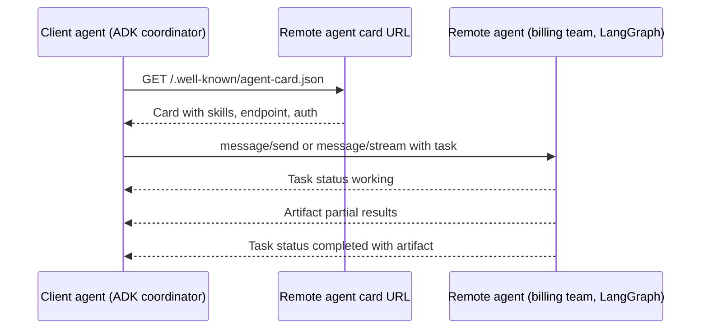

### 29.2 A2A with ADK

Expose an ADK agent:

```python
from google.adk.a2a.utils.agent_to_a2a import to_a2a
from billing_agent.agent import root_agent

a2a_app = to_a2a(root_agent, port=8001)   # ASGI app serving the agent card and A2A endpoints
# run: uvicorn billing_service:a2a_app --host 0.0.0.0 --port 8001
```

Consume a remote A2A agent as a sub-agent:

```python
from google.adk.agents.remote_a2a_agent import RemoteA2aAgent

billing_remote = RemoteA2aAgent(
    name="billing_agent",
    description="Billing team's agent: fee lookups and refund cases.",
    agent_card="https://billing-agent.internal.example.com/.well-known/agent-card.json",
)
coordinator = Agent(name="coordinator", model=FLASH, instruction="Route requests.",
                    sub_agents=[billing_remote, policy])
```

(A2A support in ADK has been marked experimental in some releases; check the current module paths.)

### 29.3 MCP or A2A?

| Use MCP when | Use A2A when |
|---|---|
| The other side is a **tool**: deterministic function, API, database | The other side is an **agent**: it reasons, may ask follow-up questions, may run for a long time |
| You control the calling agent's reasoning | The remote team owns its own prompts, models and logic |
| Same team, same repo | Cross-team, cross-org, cross-framework (ADK ↔ LangGraph ↔ CrewAI) |

In a bank, A2A shines for **domain agents owned by different teams** (fraud agent, billing agent, KYC agent) that a front-door assistant can call, with each team governing its own agent behind a stable contract.

## 30. Governance: Agent Identity, Registry, Gateway

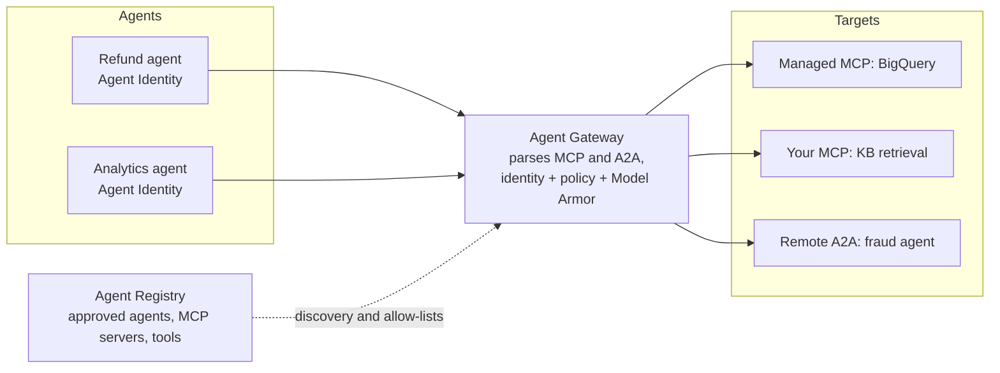

- **Agent Identity**: each agent gets its own cryptographic identity (separate from generic service accounts), so actions are attributable to *this agent* and policies can target it. This is the non-human-identity answer for agents.
- **Agent Registry**: central catalog of agents, MCP servers and tools. Teams discover approved components instead of wiring random endpoints.
- **Agent Gateway** (preview at launch): built on Envoy and Kubernetes Gateway APIs, it **understands MCP and A2A at the protocol level**, so policies can say "agent X may call tool `execute_sql_readonly` on the BigQuery MCP server, nothing else", verified by identity during the mTLS handshake. It integrates with Model Armor for prompt injection, tool poisoning and data leakage defenses.
- **Model Armor** is enabled on managed MCP servers and can screen traffic at the gateway.

How this compares with AWS: AgentCore Gateway + Policy (Cedar) + Identity cover similar ground; Google's distinctive bits are the protocol-native A2A awareness and the Registry as the discovery layer for both agents and MCP servers.

Practical starter policy for a regulated team: register every agent and MCP server; give each agent its own identity; route all tool and agent traffic through the gateway; default deny; allow-list tools per agent; log everything; run Model Armor on inputs and tool outputs.

**Level 5 check.** You can connect an ADK agent to a Google-managed MCP server with least-privilege tool filters, expose and consume an agent over A2A, and explain how Identity, Registry and Gateway fit together.

---

# Level 6: Apps on top

## 31. Gemini Enterprise (the employee app)

Gemini Enterprise (formerly Agentspace) is the **employee-facing** layer: a chat and search app where staff use Google-built agents, agents your teams publish, and agents they build themselves with no-code tools. It includes:

- **Connectors** to enterprise data (Google Workspace, Microsoft 365/SharePoint, Confluence, Jira, ServiceNow, Salesforce and more), with permission-aware search.
- **Prebuilt agents** (deep research, idea generation, NotebookLM Enterprise and others).
- An **agent gallery** where developers publish agents built on Agent Platform (ADK on Agent Runtime, A2A agents) so employees can find and use them.
- Admin controls: who can use which agents, data governance, audit.

Why you care as an AI engineer: it's the distribution channel. Instead of building a chat UI, an SSO integration and a discovery page for each internal agent, you build the agent with ADK, deploy it to Agent Runtime, register it, and publish it to Gemini Enterprise. Employees get it in the app they already use.

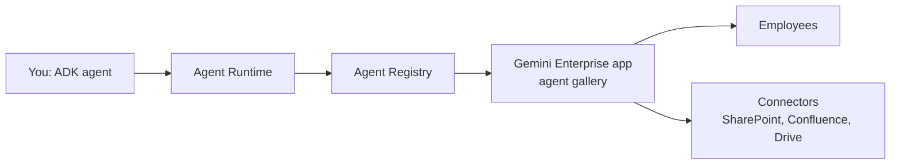

## 32. Gemini Enterprise for CX and CX Agent Studio

### 32.1 The product family

**Gemini Enterprise for Customer Experience (CX)**, launched at NRF in January 2026, is the customer-facing suite. It replaced the Contact Center AI / Customer Engagement Suite branding and includes:

| Component | What it does |
|---|---|
| **CX Agent Studio** | Build, test, deploy and monitor customer-facing chat and voice agents (GA) |
| Prebuilt agents | Shopping agent, food ordering agent, and industry templates |
| Agent Assist | Real-time help for human agents (suggestions, summaries, knowledge) |
| Conversational Insights | Analytics over customer conversations |
| Telephony and channels | Voice via partner CCaaS platforms and integrations, chat channels |

### 32.2 CX Agent Studio vs Dialogflow CX vs ADK

| | Dialogflow CX / Conversational Agents | **CX Agent Studio** | ADK + Live API (custom) |
|---|---|---|---|
| Codebase | Older (flows, pages, intents, then generative playbooks) | New codebase built for generative agents | Your code |
| Best for | Existing deployments | **New customer-facing chat/voice agents** | Unusual requirements, full control |
| Voice | Mature telephony integrations | Native multimodal/voice, telephony through partners and integrations | You build the audio pipeline (Live API) |
| Deterministic control | Flows and pages | Mix of generative behavior and deterministic capabilities | Callbacks, workflow agents |
| Ops | Managed | Managed | You run it |

Partners have been telling Dialogflow CX customers to plan migrations to CX Agent Studio. For a new voice or chat agent in the contact center, CX Agent Studio is the default; ADK is where you build the **backend tools and specialist agents** it calls.

### 32.3 How an AI engineer works with CX Agent Studio

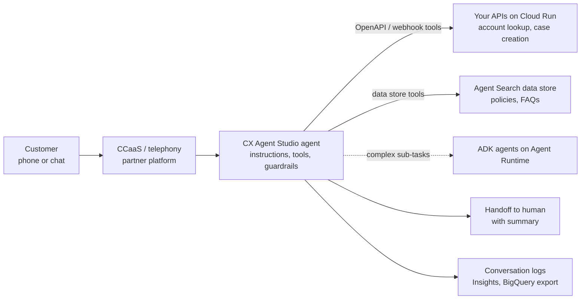

Responsibilities that usually land on you:

- **Tools**: build the backend APIs the agent calls (Cloud Run + OpenAPI spec), with auth, idempotency, timeouts short enough for voice (aim for well under a second or two per call).
- **Knowledge**: maintain the data stores (Agent Search) the agent grounds on; same ingestion discipline as any RAG system.
- **Guardrails**: what the agent must never say or do; escalation rules; PII handling in logs.
- **Versioning and environments**: draft → test → production versions, with evaluation before each promotion.
- **Evaluation**: golden conversations, simulated callers (Agent Simulation applies here too), regression runs before releases.
- **Voice specifics**: latency budget per turn, barge-in, DTMF fallbacks, number/date normalization, accent and noise robustness, graceful handoff with context to a human.
- **Analytics**: export conversation logs to BigQuery; track containment, handoff reasons, tool failure rates.

(CX Agent Studio's exact configuration surface is evolving quickly; use its release notes as your changelog.)

**Level 6 check.** You can explain where Gemini Enterprise and Gemini Enterprise for CX fit, publish an Agent Runtime agent for employees, and describe how ADK backends and APIs plug into a CX Agent Studio voice agent.

---

# Level 7: Production

## 33. Reference architectures

### 33.1 Internal knowledge assistant (fastest path)

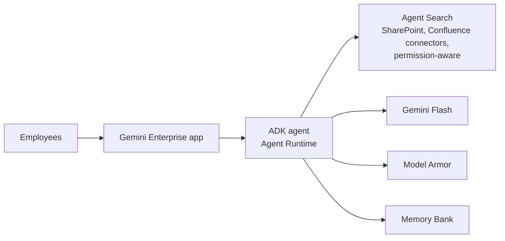

Minimal code: Agent Search handles ingestion, ACLs and ranking; the agent adds tools and policy; Gemini Enterprise is the UI.

### 33.2 Custom agentic RAG (full control)

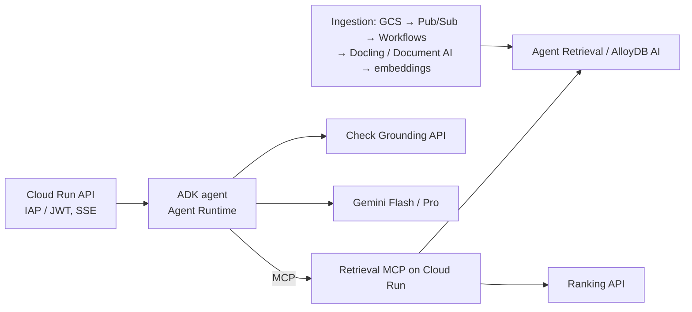

Full detail in `GCP_DeepDive.md`.

### 33.3 Multi-team agent mesh with A2A

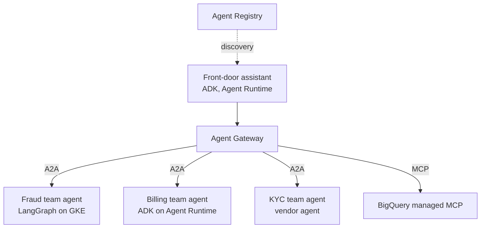

Each team owns its agent, model choices and evals; the gateway enforces who may call whom.

### 33.4 Data agent over BigQuery

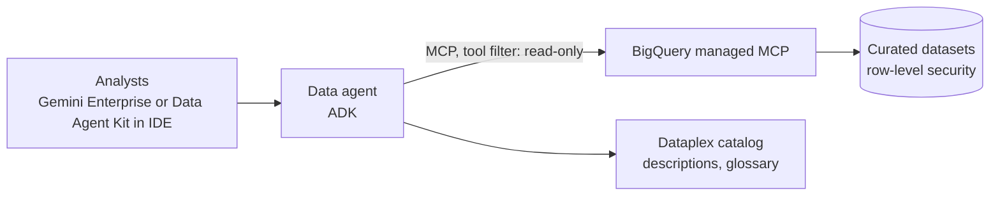

Curated datasets with good descriptions matter more than the model. Agents write better SQL against well-documented tables.

### 33.5 Document processing pipeline

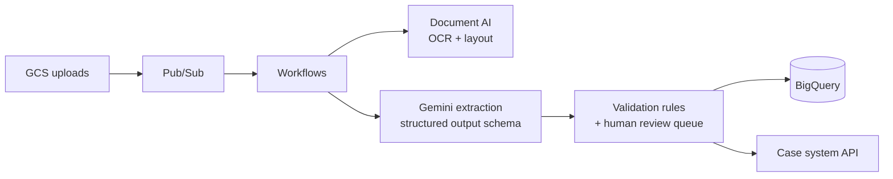

Use structured output with a Pydantic schema for extraction, validate deterministically, and send low-confidence items to humans.

### 33.6 Voice agent

CX Agent Studio front end (section 32.3) with ADK specialist agents and Cloud Run APIs behind it. For fully custom voice: ADK `run_live` with the Live API on Cloud Run, fronted by your telephony provider's media streaming.

## 34. Security and responsible AI

### 34.1 Layered controls

| Layer | Controls |
|---|---|
| Organization | Org policies (allowed regions, CMEK required, no SA keys, restrict which models/services can be used), folders per environment |
| Perimeter | **VPC Service Controls** around AI projects; PSC for APIs and endpoints; restricted egress |
| Identity | One SA (or Agent Identity) per agent; least-privilege roles; Workload Identity Federation for CI/CD; no keys |
| Data | CMEK on Agent Platform resources, GCS, BigQuery, Firestore; Sensitive Data Protection for PII discovery and de-identification |
| Model I/O | **Model Armor** templates on prompts, tool outputs and responses; Gemini safety settings; grounding checks |
| Tools | Tool filters on MCP; callbacks for authorization and approvals; Agent Gateway policies |
| Audit | Admin Activity + **Data Access audit logs** for Agent Platform, Storage, BigQuery; request/response logging for models (to BigQuery) with access controls |
| Detection | Security Command Center AI protection features (AI asset inventory, threat detection for agents), Agent Threat Detection |
| Governance commitments | Enterprise data isn't used to train Google's models; data residency options; Access Transparency / Access Approval for Google personnel access |

### 34.2 Model Armor in practice

Model Armor uses **templates** that combine filters:

| Filter | Catches |
|---|---|
| Prompt injection and jailbreak | Attacks in user input and in **retrieved or tool content** |
| Responsible AI | Hate, harassment, sexually explicit, dangerous content (confidence thresholds) |
| Sensitive Data Protection | PII and secrets (inspect or de-identify) |
| Malicious URLs | Known bad links |

Call it from ADK callbacks (input, after-tool, output), apply it through the Agent Gateway, and note that it's on by default for Google-managed MCP servers. Floor settings let security teams enforce minimum protection org-wide.

### 34.3 Regulated-industry checklist

- Model inventory: which models, versions, where, for what purpose (feeds model risk management).
- Evaluation evidence per release (section 36) stored with the release.
- Human-in-the-loop for actions with financial impact (long-running tools, approval callbacks).
- Explainability artifacts: grounding metadata, citations, tool-call traces.
- Retention policies for sessions, memories, logs; deletion paths tested.
- Third-party model review (Claude, open models) through your vendor risk process.

## 35. Observability

| Signal | Where |
|---|---|
| Traces | **Cloud Trace** via OpenTelemetry. ADK emits spans for agent runs, model calls and tool calls; Agent Runtime enables tracing with a flag; Agent Observability shows agent reasoning traces |
| Logs | Cloud Logging (structured JSON); include `trace` field to link logs to traces |
| Metrics | Cloud Monitoring: Agent Platform model request counts, latencies, token counts, 429s; Cloud Run metrics; custom metrics (tool success rate, grounding score) |
| Model I/O logs | Request-response logging for models to BigQuery (sample in prod; protect access) |
| Cost | Billing export to BigQuery, labels per agent |
| LLM-specific tools | Langfuse, Arize Phoenix, Monocle via the same OTel spans |

A dashboard I'd build first: per agent, requests, p50/p95 time to first token, tool calls per request, tool error rate, 429 rate, tokens and cost per request, grounding score distribution, thumbs-down rate.

## 36. Evaluation, simulation and optimization

Four tools, used at different times:

| Tool | When | What it measures |
|---|---|---|
| **ADK eval** (`adk eval`, pytest) | Every commit (CI) | Tool trajectories and final responses on golden conversations |
| **Gen AI evaluation service** | Release candidates, model swaps | Computation metrics (exact match, ROUGE, tool-call metrics) and model-based metrics (groundedness, fluency, instruction following, safety, custom rubrics); pointwise and pairwise; agent trajectory metrics |
| **Agent Simulation** | Before launch, major changes | Multi-turn conversations with synthetic, human-like users and virtualized tools; scores task success and safety |
| **Agent Optimizer** | After launch | Clusters real-world failures and proposes improved system instructions |

Gen AI evaluation service (SDK shape; the API has evolved from `EvalTask` to a client-style interface, so check the version you install):

```python
import pandas as pd
from vertexai.evaluation import EvalTask, MetricPromptTemplateExamples

dataset = pd.DataFrame({
    "prompt":    ["Can we refund an overdraft fee from 45 days ago?"],
    "response":  [agent_answer],                    # or let EvalTask call your model/agent
    "reference": ["Only with manager approval under the exceptions process."],
})

result = EvalTask(
    dataset=dataset,
    metrics=["exact_match",
             MetricPromptTemplateExamples.Pointwise.GROUNDEDNESS,
             MetricPromptTemplateExamples.Pointwise.INSTRUCTION_FOLLOWING],
    experiment="refund-agent-eval",
).evaluate()
print(result.summary_metrics)
```

The loop that works:

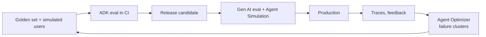

## 37. LLMOps: CI/CD and infrastructure as code

### 37.1 Start from Agent Starter Pack

```bash
pip install agent-starter-pack            # or: uvx agent-starter-pack create ...
agent-starter-pack create refund-assistant
# choose: ADK agent template, deployment target (Agent Runtime or Cloud Run),
#         CI/CD (Cloud Build or GitHub Actions), session store, data ingestion option
```

You get: agent code, a FastAPI/frontend option, Terraform for dev/staging/prod projects, CI/CD pipelines (test → eval → deploy staging → manual approval → prod), OpenTelemetry setup, and load-test scaffolding. It encodes Google's recommended layout; adapt rather than reinvent.

### 37.2 Pipeline shape

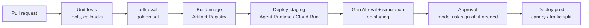

### 37.3 Terraform resources you'll meet

| Resource | Purpose |
|---|---|
| `google_project_service` | Enable APIs |
| `google_service_account`, `google_project_iam_member` | Identities and roles |
| `google_vertex_ai_reasoning_engine` | Agent Runtime instance |
| `google_vertex_ai_endpoint`, `google_vertex_ai_index`, `google_vertex_ai_index_endpoint` | Serving and Vector Search |
| `google_discovery_engine_data_store`, `google_discovery_engine_search_engine` | Agent Search |
| `google_model_armor_template` | Model Armor templates (check provider version) |
| `google_cloud_run_v2_service` / `_job` | APIs, MCP servers, workers |
| `google_storage_bucket`, `google_pubsub_*`, `google_workflows_workflow` | Pipelines |
| `google_access_context_manager_service_perimeter` | VPC-SC |

### 37.4 Versioning things that aren't code

- **Prompts/instructions**: in Git next to the agent, reviewed like code.
- **Model IDs**: in config per environment; changes go through eval.
- **Eval sets**: versioned; every production failure becomes a test case.
- **Data store / index versions**: blue/green with alias or config switch.

## 38. Cost and performance

### 38.1 What drives cost

| Driver | Lever |
|---|---|
| Output tokens (most expensive per token) | Concise instructions, structured outputs, stop sequences |
| Input tokens repeated every turn | Implicit/explicit **context caching**; stable prompt prefixes |
| Thinking tokens | Lower thinking level for routine steps |
| Number of model calls per request | Workflow agents instead of LLM routing where order is known; fewer grading loops |
| Model tier | Flash-Lite for routing/classification, Flash default, Pro only where evals show it matters |
| Offline work | **Batch prediction** (discounted) |
| Built-in tools | Search grounding is billed per grounded request; use where it adds value |
| Always-on infra | Vector Search 1.0 endpoints, Provisioned Throughput, RagManagedDb tiers, min instances |
| Agent Runtime | Billed on compute (vCPU/memory time) plus sessions/memory usage; check current pricing |

### 38.2 Latency tactics

- Stream everything; send "working on it" status events during tool calls.
- Parallel tool calls (Gemini returns several calls per turn; ADK `ParallelAgent`).
- Global endpoint (fewer capacity stalls) or Provisioned Throughput (predictable latency).
- Keep tool latency low: co-locate tools in the same region as the agent; cache reference data.
- Lower thinking level for interactive turns.

### 38.3 A quick cost formula

```
cost_per_request ≈ Σ over model calls [ (input_tokens − cached_tokens) × p_in
                                        + cached_tokens × p_cached
                                        + (output_tokens + thinking_tokens) × p_out ]
                   + grounding_requests × p_grounding
                   + retrieval + rerank + Model Armor calls
                   + runtime compute share
```

Fill in current prices per model from the pricing page, measure token counts from `usage_metadata` in traces, and keep a per-agent cost dashboard from the BigQuery billing export.

**Level 7 check.** You can pick a reference architecture for a use case, apply the security layers a bank expects, wire tracing and dashboards, run the eval → simulate → optimize loop, set up CI/CD from Agent Starter Pack, and estimate cost per request.

---

# Level 8: Getting good fast

## 39. A 90-day plan

Designed for someone who already builds agents on AWS and open source. Roughly an hour a day of deliberate practice on top of work.

### Days 1 to 30: fluency

| Week | Goal | Hands-on |
|---|---|---|
| 1 | Platform basics | Personal sandbox project; enable APIs; IAM with SA impersonation; gcloud; billing export to BigQuery; read section 2 and 3 tables until they stick |
| 2 | Gemini SDK | Gen AI SDK: structured output, function calling (manual), multimodal PDF/audio, streaming, token counting, retries, safety settings; compare outputs with your usual Claude/GPT prompts |
| 3 | Grounding and retrieval | Google Search grounding; an Agent Search data store over sample PDFs; grounding with it from Gemini; RAG Engine corpus; Ranking API; Check Grounding |
| 4 | First ADK agent | `adk create`, tools with docstrings, `adk web`, sessions/state scopes, callbacks for approval, a 10-case evalset with `adk eval` |

### Days 31 to 60: production shape

| Week | Goal | Hands-on |
|---|---|---|
| 5 | Multi-agent | Coordinator + sub-agents; Sequential/Parallel/Loop workflow; AgentTool; LiteLlm with Claude on Agent Platform |
| 6 | MCP | Connect ADK to BigQuery managed MCP with tool filters; write a FastMCP server on Cloud Run with IAM auth; connect both |
| 7 | Deploy | Agent Starter Pack project; deploy to Agent Runtime and to Cloud Run; Memory Bank; Cloud Trace; dashboard |
| 8 | Security | VPC-SC dry-run perimeter in sandbox; Model Armor template; callbacks calling Model Armor on input and tool output; Data Access audit logs |

### Days 61 to 90: depth and leverage

| Week | Goal | Hands-on |
|---|---|---|
| 9 | Evaluation | Gen AI evaluation service on 50+ cases; Agent Simulation run; make CI fail on regression |
| 10 | A2A | Expose one ADK agent via A2A; consume it from another agent (try a LangGraph agent on one side) |
| 11 | Data and BigQuery | Gemini in SQL over a table; embeddings + VECTOR_SEARCH; a data agent over curated datasets |
| 12 | Capstone | Port one of your existing AWS agents (e.g. a refund or RAG agent) to Google Cloud end to end: ADK + Agent Runtime + MCP + Agent Search/Agent Retrieval + evals + Terraform. Write a one-page AWS vs Google comparison from your experience |
| 13 | Specialize | Pick your daily-work focus: CX Agent Studio voice agents, Gemini Enterprise publishing, or data agents; build one real thing |

## 40. Certifications and learning resources

| Resource | Why |
|---|---|
| **Professional Machine Learning Engineer** certification | Covers Agent Platform ML and generative AI services; most relevant technical cert |
| **Generative AI Leader** certification | Non-technical but useful vocabulary of Google's AI portfolio; quick |
| Professional Cloud Architect | Solid foundation on IAM, networking, security (helps a lot with VPC-SC, PSC) |
| Google Cloud Skills Boost | Hands-on labs and paths for generative AI and agents |
| Google Codelabs | ADK, MCP, A2A, Agent Runtime, Vector Search 2.0 step-by-step labs |
| ADK docs + samples (`google.github.io/adk-docs`, `google/adk-samples`) | The reference you'll use daily |
| Agent Starter Pack repo | Production templates |
| `GoogleCloudPlatform/generative-ai` repo | Notebooks for nearly every Gemini and Agent Platform feature |
| Release notes: Agent Platform, ADK, CX Agent Studio | Your changelog; things change monthly |
| Google Cloud blog (AI & Machine Learning) and Next session recordings | Context on why things exist |

(Certification names and exam scopes get updated; check the current list on the Google Cloud certification site, including any newer agent-focused certification.)

## 41. Cheat sheets

### 41.1 gcloud

```bash
# Context
gcloud config set project PROJECT_ID
gcloud config set ai/region us-central1
gcloud auth application-default login --impersonate-service-account=SA_EMAIL

# APIs and IAM
gcloud services enable aiplatform.googleapis.com
gcloud projects add-iam-policy-binding PROJECT_ID \
  --member=serviceAccount:SA_EMAIL --role=roles/aiplatform.user
gcloud iam service-accounts create my-agent --display-name="My agent"

# Cloud Run
gcloud run deploy kb-retrieval --source . --region us-central1 \
  --service-account=kb-retrieval@PROJECT_ID.iam.gserviceaccount.com --no-allow-unauthenticated
gcloud run services add-iam-policy-binding kb-retrieval --region us-central1 \
  --member=serviceAccount:agent@PROJECT_ID.iam.gserviceaccount.com --role=roles/run.invoker
gcloud auth print-identity-token --audiences=https://kb-retrieval-xyz-uc.a.run.app

# Agent Platform resources
gcloud ai endpoints list --region us-central1
gcloud ai models list --region us-central1

# Logs
gcloud logging read 'resource.type="cloud_run_revision" AND severity>=ERROR' --limit 20 --freshness 1h
```

### 41.2 Python one-liners

```python
# Gemini client (enterprise)
client = genai.Client(vertexai=True, project=P, location="global")

# Structured output
client.models.generate_content(model=M, contents=x,
    config=types.GenerateContentConfig(response_mime_type="application/json", response_schema=MyModel)).parsed

# Ground on your Agent Search data store
types.Tool(retrieval=types.Retrieval(vertex_ai_search=types.VertexAISearch(datastore=DS)))

# Embeddings
client.models.embed_content(model="gemini-embedding-001", contents=[t],
    config=types.EmbedContentConfig(task_type="RETRIEVAL_DOCUMENT", output_dimensionality=768))

# ADK agent
Agent(name="x", model=M, instruction="...", tools=[fn, MCPToolset(...)], sub_agents=[...])

# Claude on Agent Platform
AnthropicVertex(project_id=P, region="global").messages.create(model=CLAUDE, max_tokens=1024, messages=[...])
```

### 41.3 Environment variables

```bash
GOOGLE_GENAI_USE_VERTEXAI=TRUE
GOOGLE_CLOUD_PROJECT=ccb-refund-agent-dev
GOOGLE_CLOUD_LOCATION=global            # or a region for regional endpoints / Agent Runtime
```

### 41.4 Where things live (API hosts)

| Service | Host |
|---|---|
| Gemini / Agent Platform | `aiplatform.googleapis.com` (`{region}-aiplatform.googleapis.com` for regional) |
| Agent Search, Ranking, Check Grounding | `discoveryengine.googleapis.com` |
| Document AI | `us-documentai.googleapis.com` or `eu-documentai.googleapis.com` |
| Model Armor | `modelarmor.{region}.rep.googleapis.com` |
| BigQuery managed MCP | `https://bigquery.googleapis.com/mcp` |
| Gemini Developer API (not for enterprise data) | `generativelanguage.googleapis.com` |

## 42. Gotchas for AWS people

1. **APIs are disabled by default.** "Permission denied" is often "API not enabled".
2. **Service agents need grants too.** When Agent Platform, Agent Search or Document AI can't read your bucket, grant the *service agent*, not just your SA.
3. **IAM changes take a minute or two to propagate.** Don't debug for an hour after a fresh binding; wait, then retry.
4. **Data Access audit logs are off by default.** Turn them on for AI services in regulated projects.
5. **VPC-SC errors look like permission errors** but mention organization policy or perimeter. Use dry-run mode and the troubleshooter.
6. **Quota is per project and region**, and Gemini uses dynamic shared capacity: design for 429s from day one.
7. **`global` vs regional** locations: models may exist in one and not the other; Agent Search uses `us`/`eu` multi-regions; Agent Runtime is regional. Mixing locations in one call is a common error.
8. **Old SDK code everywhere.** Examples using `vertexai.generative_models` or `vertexai.preview` are outdated; use `google-genai`. ADK and Agent Runtime SDKs move fast; pin versions.
9. **Product names lag in APIs.** "Agent Runtime" is a `reasoningEngines` resource; "Agent Search" is Discovery Engine; "Vector Search" is `MatchingEngine` in SDKs.
10. **Built-in tools have combination limits** with custom functions in some models; wrap them in `AgentTool`.
11. **Truncated Gemini embeddings aren't normalized.** Normalize before dot-product search.
12. **Safety filters can block legitimate banking text** (fraud, collections, disputes). Check `finish_reason`, tune settings deliberately, and document why.
13. **Projects are cheap.** Don't cram everything into one project like an AWS account; separate by environment and blast radius.
14. **Cloud Run is the default compute** for almost everything you'd put on Lambda or Fargate, including long requests (up to 60 minutes) and GPUs.
15. **Search grounding has display requirements** (show suggestions/attribution). Read the terms before shipping it to users.

## 43. Glossary

| Term | Meaning |
|---|---|
| ADC | Application Default Credentials: how Google client libraries find credentials |
| ADK | Agent Development Kit: Google's open-source agent framework |
| Agent Platform | Gemini Enterprise Agent Platform, formerly Vertex AI |
| Agent Runtime | Managed agent hosting (formerly Agent Engine / Reasoning Engine) |
| Agent Search | Managed enterprise search and RAG (formerly Vertex AI Search) |
| Agent Retrieval | Managed vector/hybrid retrieval database (formerly Vector Search 2.0) |
| A2A | Agent2Agent protocol for agent-to-agent communication |
| AgentTool | ADK wrapper that turns an agent into a callable tool |
| Agent Card | A2A metadata document describing an agent |
| CMEK | Customer-managed encryption keys (Cloud KMS) |
| CX Agent Studio | Builder for customer-facing chat/voice agents in Gemini Enterprise for CX |
| DSQ | Dynamic shared quota for Gemini capacity |
| Gemini Enterprise | Employee-facing agent and search app (formerly Agentspace) |
| Grounding | Tying model output to sources (web, your data) with citations |
| Memory Bank | Long-term memory service for agents |
| Model Armor | Prompt/response screening service (injection, safety, PII, URLs) |
| Model Garden | Catalog of first-party, partner and open models |
| MCP | Model Context Protocol: agent-to-tool protocol |
| PSC | Private Service Connect |
| PT | Provisioned Throughput |
| RAG Engine | Managed RAG corpora service |
| Service agent | Google-managed service account a service uses on your behalf |
| VPC-SC | VPC Service Controls: data exfiltration perimeter |
| Workflow agents | ADK's Sequential, Parallel and Loop agents |
| WIF | Workload Identity Federation: keyless auth from outside Google Cloud |

---

### Sources and further reading

- Gemini Enterprise Agent Platform launch (Next '26), pillars and components: https://pasqualepillitteri.it/en/news/1311/gemini-enterprise-agent-platform-google-next-2026
- Google Cloud Next '26 wrap-up (Agent Runtime, Memory Bank, Agent Simulation, Agent Optimizer): https://cloud.google.com/blog/topics/google-cloud-next/google-cloud-next-2026-wrap-up
- IT Brief: Google Cloud launches Gemini Enterprise Agent Platform: https://itbrief.co.uk/story/google-cloud-launches-gemini-enterprise-agent-platform
- The AI Track: platform components and Gemini Enterprise as employee-facing layer: https://theaitrack.com/?p=36166
- Let's Data Science: governance components (Registry, Gateway) and Gemini Embedding 2 GA: https://letsdatascience.com/news/google-launches-gemini-enterprise-agent-platform-for-governa-bebba25d
- Bain: Next 2026, the agentic enterprise control plane: https://www.bain.com/insights/google_cloud_next_2026_the_agentic_enterprise_control_plane_comes_into_view/
- 50+ Google-managed MCP servers (Next '26): https://cloud.google.com/blog/products/ai-machine-learning/google-managed-mcp-servers-are-available-for-everyone
- Managed MCP servers for Google Cloud databases: https://cloud.google.com/blog/products/databases/managed-mcp-servers-for-google-cloud-databases
- TechCrunch: Google launches managed MCP servers (Dec 2025): https://techcrunch.com/?p=3074697
- Agent Gateway, Agent Identity (protocol-native MCP/A2A gateway): https://forkast.news/google-cloud-ships-the-first-protocol-native-agent-gateway-and-it-understands-mcp-and-a2a/
- Gemini model releases (3.6 Flash, 3.5 Flash-Lite, 3.5 Flash Cyber): https://techcrunch.com/2026/07/21/google-releases-three-new-gemini-models-but-no-3-5-pro/
- Gemini 3.7 Flash: https://axios.com/2026/08/13/google-gemini-37-flash
- Gemini 4 announced, 3.5 Pro dropped: https://www.khaleejtimes.com/business/google-announces-gemini-4-flagship-ai-model-after-months-of-delays-2
- CX Agent Studio release notes (GA): https://docs.cloud.google.com/gemini-enterprise-cx/cx-agent-studio/resources/release-notes
- Gemini Enterprise for CX launch (NRF 2026): https://www.googlecloudpresscorner.com/2026-01-11-Google-Cloud-Brings-Shopping-and-Customer-Service-Together-with-Gemini-Enterprise-for-Customer-Experience
- UJET on CX Agent Studio vs Dialogflow CX: https://click.ujet.co/blog/ai-agent-building-just-got-easier-how-ujet-google-cloud-cx-agent-studio-are-redefining-automation
- Agent Retrieval (formerly Vector Search 2.0): https://docs.cloud.google.com/gemini-enterprise-agent-platform/build/vector-search-2/try-it
- ADK documentation: https://google.github.io/adk-docs/
- Google Gen AI SDK: https://googleapis.github.io/python-genai/
- Agent Starter Pack: https://github.com/GoogleCloudPlatform/agent-starter-pack
- Generative AI notebooks: https://github.com/GoogleCloudPlatform/generative-ai
- A2A protocol: https://a2a-protocol.org/
- MCP Toolbox for Databases: https://github.com/googleapis/genai-toolbox
- Model Armor: https://cloud.google.com/security-command-center/docs/model-armor-overview
- VPC Service Controls: https://cloud.google.com/vpc-service-controls/docs
